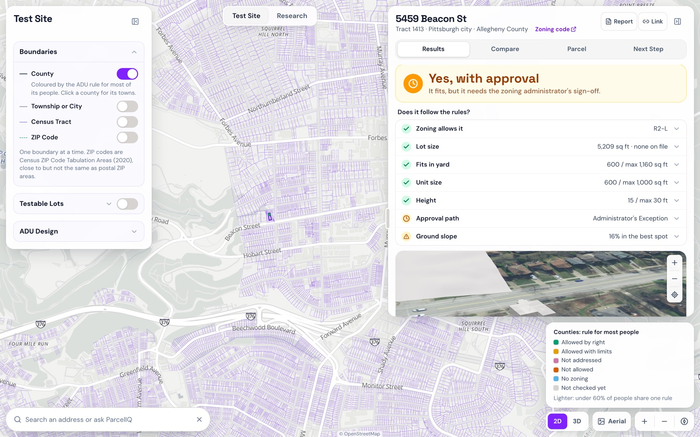

# Backyard Homes PA

**Can I build a backyard home on my lot?** This tool answers that for a single lot in Pennsylvania.

Pick a lot on the map. You get:

- **Is it allowed?** Which kinds of accessory dwelling unit (ADU: backyard cottage, garage conversion, unit in the house) the zoning allows, and what approval it needs. Every answer cites the code section.
- **Does it fit?** The biggest unit that fits in the yard after setbacks, and where it goes.
- **What does it cost and earn?** A cost estimate, the rent it could get, and how much property tax it adds.
- **What if the law changes?** The same lot under pending bills, such as HB 2186.
- **What next?** The lot's parcel facts, its zoning district, town documents, who to call, and what to bring.

<h2 align="center">👉 <a href="https://pa-adu.vercel.app">pa-adu.vercel.app</a></h2>



*A Pittsburgh lot: the unit fits, but it needs the zoning administrator's sign-off.*

> Not legal advice. Not a zoning determination. Parcel lines are not a survey. Bills are not law.

## Ask ParcelIQ

The search box doubles as a chat assistant. Ask things like *"Can I build an ADU here?"*, *"What's the rear yard rule?"* or *"Try a two-story 800 sq ft unit."* It answers only from the tool's own data, with citations, and says "not on file" instead of guessing. It runs on Claude Haiku 5.5.

## Where it works

| Lot-level answers | Lots |
|---|---|
| Philadelphia | 459,998 |
| Pittsburgh | 92,081 |
| Allentown | 29,158 |
| Montgomery County: Lower Merion, Narberth, Upper Dublin | 26,119 |
| Chester County: West Chester, Phoenixville, West Vincent, Malvern, East Brandywine | 14,847 |
| Centre County: College Township | 3,484 |
| **Total** | **625,687** |

Outside these places, the map still shows the ADU rule for every county, town, census tract and ZIP code in Pennsylvania. 223 towns have their own rule file (146 checked by a second reading). Every other town uses a statewide baseline.

## How it works

1. **Rules.** Each town's zoning code is read into a rule file with the section and link behind every number (`shared/rules/`).
2. **Lots.** Parcel lines, buildings and streets go through a geometry test that finds the largest unit that fits within the setbacks.
3. **Land cover.** A deep learning model on 2022 aerial photos maps trees, open ground and paving on each lot (MUSA 6950).
4. **Money.** Costs come from one assumptions file, and rents from HUD Small Area Fair Market Rents.

How each part works is in [docs/METHODS.md](docs/METHODS.md). Coverage by town, the three scenarios, model accuracy and what is not finished yet are in [docs/LIMITS.md](docs/LIMITS.md).

## Run it locally

```bash
npm install
npm run dev        # http://localhost:5173
```

Lot records live on a data drive outside the repo (`ADU_DATA_DIR`, default `~/musa-drive`). Ask needs `ANTHROPIC_API_KEY` in a repo-root `.env`. Tests:

```bash
npm test
/opt/anaconda3/envs/geospatial/bin/python -m pytest -q tests
```

The full pipeline, from downloads to lot files, is in [docs/RUNNING.md](docs/RUNNING.md).

## Folders

| Folder | What's in it |
|---|---|
| `app/` | The website and tool (React, Vite, MapLibre) |
| `agent/`, `api/` | ParcelIQ: the server function, tools and the eval |
| `pipeline/` | Data builds: places, rules, fit test, lots, money, land cover |
| `shared/` | Rule files with citations, money assumptions |
| `musa6950/` | Course notebooks and write-ups |
| `docs/` | Methods, data sources, model cards, changelog |

## About

Final project for MUSA 6950 (remote sensing and deep learning), University of Pennsylvania, Fall 2026. The MUSA 5500 half (housing demand across Pennsylvania) is at https://github.com/yezhanggg/YZMUSA5500.

Code: Apache-2.0. Data sources keep their own terms ([docs/LICENSES.md](docs/LICENSES.md)).
