# Architecture

This product answers one question for a home lot in Pennsylvania: can a backyard home (an ADU) go here, how big, under which rules, and does it pay. Philadelphia (459,998 lots) and Pittsburgh (92,081 lots) are covered lot by lot. For 36 more towns the product has a hand-checked rule file, and for every other Pennsylvania town a statewide baseline. Those towns have rules but no lot files.

<!-- source: ~/musa-drive/lots/<city>/manifest.json counts.lots (Pittsburgh pittsburgh-20261111-bdeb5697ae, Philadelphia build of 2026-11-11T21:41:43), shared/rules/towns_index.json -->

Not legal advice. Not a zoning determination. Parcel lines are not a survey.

## Three steps for the user

| Step | What the user does | What answers it |
|---|---|---|
| Find | Search an address or pan the map. Pick a lot. | The lot index and the per-tract lot files (`lots/<place>/index.parquet`, `app/<GEOID>.json`, `detail/<GEOID>.json.gz`) |
| Test | Draw or size a unit. See if it fits, under which scenario, and why not. | The saved lot record (rules, buildable ground, fit per ADU type), checked again in the browser by `app/src/lib/lot/verdict.ts` and `app/src/lib/fitBox.ts` |
| Build | Read the steps from rules to rental license, with fees and the money picture. | `app/src/lib/lot/buildSteps.ts` and the money model (`pipeline/money.py`, `app/src/lib/money.ts`) |

The browser library for these steps is in `app/src/lib/lot/`. The Testing mode of the tool uses it (`app/src/tool/test/`), and so do the assistant's lot tools. See [app/src/lib/lot/README.md](../app/src/lib/lot/README.md).

## Data flow

```mermaid
flowchart LR
  subgraph Sources
    A[City and county layers<br>parcels, footprints, zoning,<br>overlays, flood, slope, streets]
    B[Assessor tables<br>OPA, Allegheny assessments]
    C[OSM service roads<br>Microsoft footprints]
    D[Census TIGER tracts]
    E[HUD SAFMR rents]
    G[City land cover rasters<br>NAIP 2022 model cover]
  end
  subgraph Place tables
    P[processed/place/<br>lots, buildings, streets, alleys]
  end
  subgraph Rules and fit
    R[shared/rules/*.json<br>pipeline/rules.py]
    F[pipeline/fit.py]
  end
  subgraph Lot files
    L[lots/place/<br>detail, index, app, manifest]
  end
  APP[app/src/lib/lot<br>Find, Test, Build]
  A --> P
  B --> P
  C --> P
  P --> L
  D --> L
  E --> L
  R --> L
  F --> L
  G --> L
  L --> APP
  M[shared/assumptions.json<br>pipeline/money.py, money.ts] --> APP
```



In words:

1. Each place module downloads its layers once into `raw/<place>/` and records each one in `raw/<place>/SOURCES.json`.
2. The place `build` step joins parcels, assessor rows, zoning, overlays, flags and building outlines into one lots table and one buildings table per place, in `processed/<place>/`.
3. The lot builder (`pipeline/build_lots.py`) reads those tables. For every lot and each of the three scenarios (today, local reform, state reform) it resolves the rules (`pipeline/rules.py`), finds the front, rear and side lot lines, cuts the buildable ground and fits each allowed ADU type (`pipeline/fit.py`). The fit is a vector geometry test on lot, building and street lines with rule-based setbacks.
4. It joins land cover per lot and reads what lies inside the suggested spot (trees a unit would remove, open ground, hard surface). Land cover is context. It does not move or block the unit.
5. It writes one validated JSON record per lot, grouped by 2020 census tract, plus a compact index, the current app's per-tract lists and a manifest.
6. The browser loads a tract file, shows the saved answer, and tests a unit the user draws against the saved buildable ground.

Land cover and the detector, by city:

| | Philadelphia | Pittsburgh |
|---|---|---|
| Lot `cover` block | The city's 2018 land cover raster (`landcover_2018`), because the model is not reliable for tree and open ground on NAIP 2022 here | The land cover model `r34_c5_s0` on NAIP 2022 (`model:r34_c5_s0`), from `cover_model_r34_c5_s0.parquet` |
| Cover inside the suggested spot (`spot_cover`) | From the same raster | From the same model maps |
| Detector objects | Not in the lot records (`objects` is empty) | Not in the lot records (`objects` is empty) |

<!-- source: pipeline/build_lots.py COVER_FILES_BY_PLACE, COVER_NOTES, SPOT_COVER, line "objects": []. pipeline/vision/raster_cover.py finalize(). ~/musa-drive/processed/<city>/cover.parquet cover_source column -->

- The land cover model (`pipeline/vision/`) scores aerial images as building, tree, open ground, hard surface and other. See [MODEL_CARD_landcover.md](MODEL_CARD_landcover.md).
- The object detector (`musa6950/yolo/`) finds garages, sheds, other accessory buildings and pools in sample areas only. It writes `processed/yolo/detections_<city>.parquet`. Its labels are first pass and its scores are not a true accuracy, so it does not feed the lot records. Garages and sheds in the fit come from building outlines.

## Three tiers of zoning knowledge

Not legal advice. Not a zoning determination. Parcel lines are not a survey.

| Tier | Where | What it holds | Used by |
|---|---|---|---|
| 1. Lot-level rules | Philadelphia and Pittsburgh (`shared/rules/philadelphia.json`, `pittsburgh.json`, plus the bill files) | Every rule resolved for every lot and scenario, with district setbacks and overlays, saved in the lot record | Lot files, Testing mode, the assistant's lot tools |
| 2. Town rule files | 36 towns beyond the two cities, ranks 3 to 38 by 2020 population (`shared/rules/pa_<county>_<town>.json`). 21 verified, 15 drafted with a stated open point | ADU status, approval path, size, owner occupancy, conditions and other ways to add a unit, each cited. No lot files | The assistant (`get_rule_text`, `list_rule_places`), `pipeline/rules.py` town resolver, [RULES_TOWNS.md](RULES_TOWNS.md) |
| 3. Statewide baseline | Every other Pennsylvania town (`shared/rules/pa_statewide.json`) | MPC approval paths, building code, sewage rules, the pending bills. No town zoning numbers | The assistant, which says the answer is the statewide baseline and not the town's own code |

<!-- source: shared/rules/towns_index.json (status per town), shared/rules/pa_*.json, app/src/agent/ruleText.ts, agent/schema.ts SYSTEM_PROMPT -->

A machine-read pilot of town ordinance text (`pipeline/corpus/`) sits outside the product. It is not in the app or the assistant. See [CORPUS.md](CORPUS.md).

## Module map

| Path | Role |
|---|---|
| `pipeline/paths.py` | Data root from `ADU_DATA_DIR`. Folders for raw, processed and logs |
| `pipeline/places/common.py` | ArcGIS downloads with paging and retry, safe table writes, `SOURCES.json`, spatial joins, cutting shared outlines along lot lines |
| `pipeline/places/philadelphia.py` | Philadelphia download, build, check, fit sample run, garage check chips |
| `pipeline/places/pittsburgh.py` | Pittsburgh download, build, check |
| `pipeline/tract/` | Tract analysis for the class work: growth, groups, payoff, forecast, county roll-up |
| `pipeline/tracts.py` | Downloads the 2020 TIGER tract file for Pennsylvania and tags lots with a tract |
| `shared/rules/*.json` | Cited rule files: one per city, one per town (`pa_<county>_<town>.json`), one per bill, a default, the statewide baseline (`pa_statewide.json`), the schema and the town index (`towns_index.json`) |
| `pipeline/rules.py` | Validates rule files and resolves them for one lot and one scenario. Cities and towns have separate resolvers |
| `pipeline/fit.py` | Vector fit engine: lot lines, setbacks, buildable ground, largest rectangle, fit per ADU type |
| `pipeline/lot.py`, `pipeline/lot_schema.json` | The lot record contract and its validator |
| `pipeline/build_lots.py` | Lot file builder: `run`, `validate`, `stats`, `qa` |
| `pipeline/market.py` | HUD Small Area Fair Market Rents for Pennsylvania ZIP codes |
| `pipeline/money.py`, `shared/assumptions.json` | Cost, rent and pay-off model. Every number lives in the assumptions file |
| `pipeline/vision/` | Land cover U-Net: labels, training, scoring, error analysis, city label sets (`city.py`, `city_check.py`), land cover per lot from the model (`infer_lots.py`) or a city raster (`raster_cover.py`), and cover inside any polygon (`cover_lookup.py`) |
| `pipeline/validation/` | Hand-label check of the lot answers: draw a sample, make labeling sheets, score hand labels against the product. No labels yet |
| `pipeline/corpus/` | Machine-read zoning text pilot. Not in the product |
| `musa6950/yolo/` | Object detector. Uses an AGPL library and is kept in its own folder. Only data files leave it |
| `app/src/lib/lot/` | Browser side: load lot files, verdict, citations, build steps, report data, lot tools for the assistant |
| `app/src/agent/`, `agent/`, `api/agent.ts` | The Ask assistant: tool schemas and system prompt, tools that run in the browser, the server function that calls the model, and the eval |
| `app/src/lib/fitBox.ts` | Does a box fit inside the saved buildable outline (browser) |
| `app/src/lib/money.ts` | Same money model as `pipeline/money.py`, line for line |
| `tests/` | Python tests. Browser tests sit beside each TypeScript file |

## Where data lives

Data stays off the code checkout. One environment variable points at the data root:

```
ADU_DATA_DIR   default ~/musa-drive
```

| Folder under the data root | What is in it |
|---|---|
| `raw/<place>/` | Layers as downloaded (GeoPackage, Parquet) and `SOURCES.json` |
| `raw/tiger/` | `tl_2020_42_tract.zip`, the statewide 2020 tract file |
| `raw/market/` | HUD SAFMR download, Freddie Mac PMMS history, DoD area cost factors |
| `raw/imagery/<city>/` | Detector sample areas, image chips and chip list |
| `processed/<place>/` | `lots.parquet`, `buildings.parquet`, `streets.parquet`, `alleys.parquet` (Philadelphia), `lot_tracts.parquet`, `join_check.json`, `overlay_check.json` (Philadelphia), land cover per lot (`cover.parquet`, `cover_raster.parquet`, `cover_model*.parquet`) and `cover_compare*.json` |
| `processed/market/` | `safmr_pa.parquet` |
| `processed/vision/` | Land cover labels, caches, class shares, error analysis and the city checks |
| `processed/yolo/` | Detector dataset, review pack, detections per lot |
| `lots/<place>/` | Lot files: `detail/`, `parts/`, `index.parquet`, `app/`, `manifest.json`, `progress.jsonl`, `errors.jsonl`, `stats.json`, `qa/` |
| `models/` | Land cover runs (one folder per run) and detector runs |
| `raw/landcover/<city>/`, `raw/naip/<city>/` | City land cover rasters and NAIP tiles for the city label sets |
| `validation/` | Hand-label sample, sheets, labeling pages and results |
| `corpus/` | Machine-read pilot: fetched ordinances, text, chunks, search index, drafts and results |
| `ops/logs/` | Run notes |

Some exceptions read other paths:

- `musa6950/yolo/config.py` uses `~/musa-drive` directly, not `ADU_DATA_DIR`.
- `pipeline/vision/data.py` reads its NAIP images and labels from the course checkout (`ADU_VISION_SOURCE`, default `~/Documents/YZ-MUSA-FINAL/data/raw/6950`).

## Coordinates

All lengths and areas are computed in a local state plane in feet: EPSG:2272 (NAD83 Pennsylvania South, US feet) for both cities. It is set as `WORK_CRS` in `pipeline/places/philadelphia.py` and `pipeline/places/pittsburgh.py`. Pittsburgh was built in EPSG:2271 (the North zone) before Nov 11, 2026. The current Pittsburgh lot files (data version `pittsburgh-20261111-bdeb5697ae`) record `crs_local` 2272. Lot records store geometry as GeoJSON in WGS84 for the map, and name the local system in `lot.crs_local`.

## Ids

A lot id is the county FIPS code, a dash, and the county parcel id. Philadelphia uses the 9 digit OPA account (`42101-051151530`). Pittsburgh uses the county parcel id (`42003-0001D00128000000`). Ids never clash across places.

## Safe writes

Tables that other jobs may read are written under a temporary name, the old file is kept as `<name>.prev.parquet`, and one rename swaps them. A stopped run never leaves half a file. The lot builder records each finished tract in `progress.jsonl` and skips it on the next run.

## Related documents

- [DATA.md](DATA.md): every data set
- [METHODS.md](METHODS.md): how the fit, rules, models and money work
- [RULES.md](RULES.md): what the rule files say today
- [RULES_TOWNS.md](RULES_TOWNS.md): the town rule files
- [CORPUS.md](CORPUS.md): the machine-read zoning pilot
- [MODEL_CARD_landcover.md](MODEL_CARD_landcover.md), [MODEL_CARD_detector.md](MODEL_CARD_detector.md): the two image models
- [RUNNING.md](RUNNING.md): commands
- [ADDING_A_CITY.md](ADDING_A_CITY.md): the recipe for a new place
- [LICENSES.md](LICENSES.md): terms for data, models and libraries
