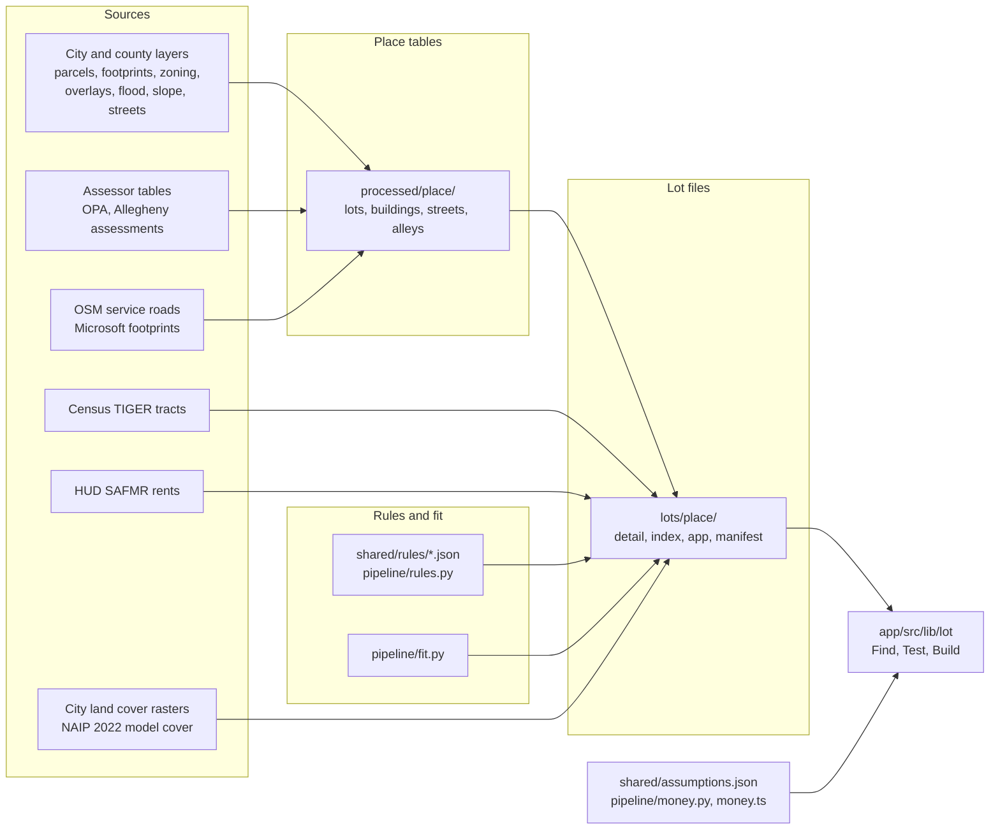

# Architecture

This product answers one question for a home lot in Pennsylvania: can a backyard home (an ADU) go here, how big, under which rules, and does it pay. Six lot places are covered lot by lot: Philadelphia (459,998 lots), Pittsburgh (92,081), Allentown (29,158), and parts of Montgomery County (26,119), Chester County (14,847) and Centre County (3,484), 625,687 lots in all. 131 towns have a hand-checked rule file (10 of them are in the lot places). Every Pennsylvania place gets one answer from the answer ladder, down to a statewide baseline. Towns outside the lot places have rules but no lot files.

<!-- source: ~/musa-drive/lots/<place>/manifest.json counts.lots (data versions of 2026-11-14 and 15: pittsburgh-20261114-7ae3f25d22, philadelphia-20261114-2a67293eaa, allentown-20261115-4318818527, chester_county-20261115-95284f3b37, centre_county-20261115-43434a1b88, montgomery_county-20261115-5b26a34d9b), shared/rules/towns_index.json at commit ce8d21a -->

Not legal advice. Not a zoning determination. Parcel lines are not a survey.

## Three steps for the user

| Step | What the user does | What answers it |
|---|---|---|
| Find | Search an address or pan the map. Pick a lot. | The lot index and the per-tract lot files (`lots/<place>/index.parquet`, `app/<GEOID>.json`, `detail/<GEOID>.json.gz`) |
| Test | Draw or size a unit. See if it fits, under which scenario, and why not. | The saved lot record (rules, buildable ground, fit per ADU type), checked again in the browser by `app/src/lib/lot/verdict.ts` and `app/src/lib/fitBox.ts` |
| Build | Read the steps from rules to rental license, with fees and the money picture. | `app/src/lib/lot/buildSteps.ts` and the money model (`pipeline/money.py`, `app/src/lib/money.ts`) |

The browser library for these steps is in `app/src/lib/lot/`. The Testing mode of the tool uses it (`app/src/tool/test/`), and so do the assistant's lot tools. See [app/src/lib/lot/README.md](../app/src/lib/lot/README.md).

## Data flow



In words:

1. Each place module downloads its layers once into `raw/<place>/` and records each one in `raw/<place>/SOURCES.json`.
2. The place `build` step joins parcels, assessor rows, zoning, overlays, flags and building outlines into one lots table and one buildings table per place, in `processed/<place>/`.
3. The lot builder (`pipeline/build_lots.py`) reads those tables. For every lot and each of the three scenarios (today, local reform, state reform) it resolves the rules (`pipeline/rules.py`), finds the front, rear and side lot lines, cuts the buildable ground and fits each allowed ADU type (`pipeline/fit.py`). The fit is a vector geometry test on lot, building and street lines with rule-based setbacks.
4. It joins land cover per lot and, in all six places, reads what lies inside the suggested spot (trees a unit would remove, open ground, hard surface). Land cover is context. It does not move or block the unit.
   A later refresh step (`build_lots terrain`) adds ground slope from the USGS 3DEP 1 m DEM: over the lot, the buildable ground and under the suggested spot, a steep flag and a second fit on ground under 25 percent. Slope is context too. It does not change the fit's yes or no.
5. It writes one validated JSON record per lot, grouped by 2020 census tract, plus a compact index, the current app's per-tract lists and a manifest.
6. The browser loads a tract file, shows the saved answer, and tests a unit the user draws against the saved buildable ground.

Land cover and the detector, by place:

| | Philadelphia | Pittsburgh | Allentown and the three county places |
|---|---|---|---|
| Lot `cover` block | The city's 2018 land cover raster (`landcover_2018`), because the model is not reliable for tree and open ground on NAIP 2022 here | The land cover model `r34_c5_s0` on NAIP 2022 (`model:r34_c5_s0`), from `cover_model_r34_c5_s0.parquet` | The same model, from `cover.parquet` (Nov 14). Validated only in Centre County (a Chesapeake test county). 36 Centre County lots have none |
| Cover inside the suggested spot (`spot_cover`) | From the same raster | From the same model maps | From the same model maps (since the Nov 15 rebuild) |
| Detector objects | Not in the lot records (`objects` is empty) | Not in the lot records (`objects` is empty) | Not in the lot records |

<!-- source: pipeline/build_lots.py COVER_FILES_BY_PLACE, COVER_NOTES, SPOT_COVER, line "objects": []. pipeline/vision/cover_lookup.py MODEL_RUNS. pipeline/vision/raster_cover.py finalize(). ~/musa-drive/processed/<city>/cover.parquet cover_source column -->

- The land cover model (`pipeline/vision/`) scores aerial images as building, tree, open ground, hard surface and other. See [MODEL_CARD_landcover.md](MODEL_CARD_landcover.md).
- The object detector (`musa6950/yolo/`) finds garages, sheds, other accessory buildings and pools in sample areas only. It writes `processed/yolo/detections_<city>.parquet`. Its labels are first pass and its scores are not a true accuracy, so it does not feed the lot records. Garages and sheds in the fit come from building outlines.

## Three tiers of zoning knowledge

Not legal advice. Not a zoning determination. Parcel lines are not a survey.

| Tier | Where | What it holds | Used by |
|---|---|---|---|
| 1. Lot-level rules | The six lot places (`shared/rules/philadelphia.json`, `pittsburgh.json`, the town files of Allentown and the 9 county-place towns, plus the bill files) | Every rule resolved for every lot and scenario, with district setbacks and overlays, saved in the lot record | Lot files, Testing mode, the assistant's lot tools |
| 2. Town rule files | 116 towns beyond the two cities, mostly the largest by 2020 population (`shared/rules/pa_<county>_<town>.json`). With the two cities, 88 verified and 45 drafted with a stated open point (2026-11-15) | ADU status, approval path, size, owner occupancy, conditions and other ways to add a unit, each cited. Lot files only for the towns in the lot places | The assistant (`get_rule_text`, `list_rule_places`), `pipeline/rules.py` town resolver, [RULES_TOWNS.md](RULES_TOWNS.md) |
| 2b. Public zoning text (unverified) | 66 towns with a public copy of the ordinance on the town or a county site (`<data root>/corpus/tierb/`, published as `zoning_text/` next to the lot data) | Passages copied word for word, with section, pages, link and fetch date. No verdict | The assistant (`search_zoning_text`, `list_text_places`), only for a town with no rule file or a detail the rule file lacks. Labelled "unverified text search" |
| 3. Statewide baseline | Every other Pennsylvania town (`shared/rules/pa_statewide.json`) | MPC approval paths, building code, sewage rules, the pending bills. No town zoning numbers | The assistant, which says the answer is the statewide baseline and not the town's own code |

<!-- source: shared/rules/towns_index.json (status per town), shared/rules/pa_*.json, app/src/agent/ruleText.ts, agent/schema.ts SYSTEM_PROMPT -->

Tier 2b is built by `pipeline/corpus/tierb.py` from the machine-read pilot (`pipeline/corpus/`). The pilot's machine drafts (status, path, districts) stay out of the product. See [CORPUS.md](CORPUS.md).

## How the assistant answers

For any question about what a Pennsylvania municipality allows, the assistant calls `get_place_answer` first
(`app/src/agent/placeAnswer.ts`). For one lot in a place with lot records (Pittsburgh, Philadelphia, Allentown, Chester County, Centre County, Montgomery County: the
list comes from `PLACE_BY_COUNTY` in `app/src/lib/lot/load.ts` through `app/src/agent/lotPlaces.ts`, so the wording
needs no change for a new city) the lot tools come first. The tool
resolves the place (name, "name, county", GEOID, or the town selected on the map; a shared name such as the 22
Washington townships gets a question back, never a guess), reads its row in `app/public/data/pa_places.json` and
walks the ladder. The assistant never answers "I don't know": it gives the best grounded answer with its label and the
next step, and never invents a rule, a section or a number.

| Tier | Where from | What the answer says | Confidence label |
|---|---|---|---|
| verified | Hand-checked rule file | The rule as fact: forms, size cap, approval, conditions, sections | "Checked rule file, verified on <date>" |
| drafted | Rule file with open points | The answer, plus the open points | "First reading of the town's code (<date>), with open points" |
| reported | Dated public record (DCED Municipal Statistics: no zoning ordinance) | "Allowed, no zoning here": building code, sewage permits, deeds still apply | "<publisher> (<year>) lists ... Not checked against the code here" |
| text_search | Public zoning text (tier 2b) | Quoted passages, no verdict, plus the statewide baseline | "Unverified text search" |
| baseline | `shared/rules/pa_statewide.json` | Who zones here (own, county or none), the MPC paths, the bills (not law), who to ask and the question to ask | "Statewide baseline, not this town's code" |

With a unit type or size, the tool also checks the proposal against the rule file (form allowed, size cap) and says
why it fits or not. The answer format (verdict line, "Zoning here allows", "Your proposal", "Why it does or does not
fit", source and confidence, "Next step") is in the system prompt (`agent/schema.ts`). Eval: `agent/eval/questions_ladder.json`.

What the tool results carry so the model does not have to infer it (the prompt stays short):

- Rule text from the resolver: a status per form (`adu.status_by_form`, `approval.by_form_today`) gives a "Depends on
  the form" verdict with one line per form; a lesser-of cap comes as one sentence (`size_rule_*`, "At most 1,000 sq ft
  or 50% of the house, whichever is less"); `who_decides` names the body that hears a special exception (Zoning
  Hearing Board) or conditional use (governing body), per form; a `code_caution` line (placeholder code, amendments not
  seen) comes first; an ADU under another listing is named as such. A proposal check says the share-of-house cap is
  "Not checked" when the house size is not known.
- Text search: every passage sits in a `quote` field, with a `quote_rule` line (copy character for character, cut with
  "..." around stray marks, never fix a word) and `text_kind` ("scanned text, quoted as read" for OCR). In scanned
  text a misread word stays misread inside the quotes (`SCANNED_NOTE`). To fix it, the answer says that piece in its own
  words outside the quotes. A search with
  no match returns `say_exactly: "Not found in the text searched."` and a `not_found_rule`.
- Lot records: a check the record cannot test (no house size, no land cover block) has `pass: "not checked"`, and
  `test_unit_on_lot` lists them under `not_checked`. A record with land cover gives a `land_cover` block in
  `get_lot_facts` (and in `test_unit_on_lot` for a backyard cottage): tree, paving, open ground and building shares of
  the whole lot, the record's accuracy note from `quality.assumptions`, and the trees and paving inside the suggested
  spot, or a line saying they are not available for the place. A `rule` line says to give the accuracy note with the
  figures.
- Address search: `find_lot` reads a static address index per place (`<place>/addresses/`, 3.6 MB for the six
  places, in the lot data bundle, see [DATA.md](DATA.md#address-index)). It finds any address in a lot place, on the
  map or not. It works on the live site only once the bundle is published.

Eval files: `questions.json` (generated, two cities), `questions_tierb.json`, `questions_ladder.json`,
`questions_allentown.json` and `questions_rule_text.json` (both from `agent/eval/make_more_questions.ts`), and
`questions_features.json` (from `agent/eval/make_feature_questions.ts`). 119 questions in all. The scorer
checks that quoted spans are in a tool result; words the user asked or the assistant searched for are matched word by
word with plurals folded.

## Module map

| Path | Role |
|---|---|
| `pipeline/paths.py` | Data root from `ADU_DATA_DIR`. Folders for raw, processed and logs |
| `pipeline/places/common.py` | ArcGIS downloads with paging and retry, safe table writes, `SOURCES.json`, spatial joins, cutting shared outlines along lot lines |
| `pipeline/places/philadelphia.py` | Philadelphia download, build, check, fit sample run, garage check chips |
| `pipeline/places/pittsburgh.py` | Pittsburgh download, build, check |
| `pipeline/tract/` | Tract analysis for the class work: growth, groups, payoff, forecast, county roll-up |
| `pipeline/tracts.py` | Downloads the 2020 TIGER tract file for Pennsylvania and tags lots with a tract |
| `shared/rules/*.json` | Cited rule files: one per city, one per town (`pa_<county>_<town>.json`), one per bill, a default, the statewide baseline (`pa_statewide.json`), the schema and the town index (`towns_index.json`) |
| `pipeline/rules.py` | Validates rule files and resolves them for one lot and one scenario. Cities and towns have separate resolvers |
| `pipeline/fit.py` | Vector fit engine: lot lines, setbacks, buildable ground, largest rectangle, fit per ADU type |
| `pipeline/lot.py`, `pipeline/lot_schema.json` | The lot record contract and its validator |
| `pipeline/build_lots.py` | Lot file builder: `run`, `validate`, `stats`, `qa`, and the refresh steps `cover` (land cover) and `terrain` (ground slope), which fold a block into built records without a fit rerun |
| `pipeline/terrain.py` | Ground slope from the 3DEP 1 m DEM: slope grid in EPSG:2272, slope over the lot, buildable ground and best spot, and the fit on ground under 25 percent |
| `pipeline/market.py` | HUD Small Area Fair Market Rents for Pennsylvania ZIP codes |
| `pipeline/money.py`, `shared/assumptions.json` | Cost, rent and pay-off model. Every number lives in the assumptions file |
| `pipeline/vision/` | Land cover U-Net: labels, training, scoring, error analysis, city label sets (`city.py`, `city_check.py`), land cover per lot from the model (`infer_lots.py`) or a city raster (`raster_cover.py`), and cover inside any polygon (`cover_lookup.py`) |
| `pipeline/validation/` | Hand-label check of the lot answers: draw a sample, make labeling sheets, score hand labels against the product. No labels yet |
| `pipeline/corpus/` | Machine-read zoning text pilot. Not in the product |
| `musa6950/yolo/` | Object detector. Uses an AGPL library and is kept in its own folder. Only data files leave it |
| `app/src/lib/lot/` | Browser side: load lot files, verdict, citations, build steps, report data, lot tools for the assistant |
| `app/src/agent/`, `agent/`, `api/agent.ts` | The Ask assistant: tool schemas and system prompt, tools that run in the browser, the server function that calls the model, and the eval |
| `app/src/lib/fitBox.ts` | Does a box fit inside the saved buildable outline (browser) |
| `app/src/lib/money.ts` | Same money model as `pipeline/money.py`, line for line |
| `tests/` | Python tests. Browser tests sit beside each TypeScript file |

## Where data lives

Data stays off the code checkout. One environment variable points at the data root:

```
ADU_DATA_DIR   default ~/musa-drive
```

| Folder under the data root | What is in it |
|---|---|
| `raw/<place>/` | Layers as downloaded (GeoPackage, Parquet) and `SOURCES.json` |
| `raw/tiger/` | `tl_2020_42_tract.zip`, the statewide 2020 tract file |
| `raw/market/` | HUD SAFMR download, Freddie Mac PMMS history, DoD area cost factors |
| `raw/imagery/<city>/` | Detector sample areas, image chips and chip list |
| `processed/<place>/` | `lots.parquet`, `buildings.parquet`, `streets.parquet`, `alleys.parquet` (Philadelphia), `lot_tracts.parquet`, `join_check.json`, `overlay_check.json` (Philadelphia), land cover per lot (`cover.parquet`, `cover_raster.parquet`, `cover_model*.parquet`) and `cover_compare*.json` |
| `processed/market/` | `safmr_pa.parquet` |
| `processed/vision/` | Land cover labels, caches, class shares, error analysis and the city checks |
| `processed/yolo/` | Detector dataset, review pack, detections per lot |
| `lots/<place>/` | Lot files: `detail/`, `parts/`, `index.parquet`, `app/`, `manifest.json`, `progress.jsonl`, `errors.jsonl`, `stats.json`, `qa/` |
| `models/` | Land cover runs (one folder per run) and detector runs |
| `raw/landcover/<city>/`, `raw/naip/<city>/` | City land cover rasters and NAIP tiles for the city label sets |
| `validation/` | Hand-label sample, sheets, labeling pages and results |
| `corpus/` | Machine-read pilot: fetched ordinances, text, chunks, search index, drafts and results |
| `ops/logs/` | Run notes |

Some exceptions read other paths:

- `musa6950/yolo/config.py` uses `~/musa-drive` directly, not `ADU_DATA_DIR`.
- `pipeline/vision/data.py` reads its NAIP images and labels from the course checkout (`ADU_VISION_SOURCE`, default `~/Documents/YZ-MUSA-FINAL/data/raw/6950`).

## Coordinates

All lengths and areas are computed in a local state plane in feet: EPSG:2272 (NAD83 Pennsylvania South, US feet) for both cities. It is set as `WORK_CRS` in `pipeline/places/philadelphia.py` and `pipeline/places/pittsburgh.py`. Pittsburgh was built in EPSG:2271 (the North zone) before Nov 11, 2026. The current Pittsburgh lot files (data version `pittsburgh-20261111-bdeb5697ae`) record `crs_local` 2272. Lot records store geometry as GeoJSON in WGS84 for the map, and name the local system in `lot.crs_local`.

## Ids

A lot id is the county FIPS code, a dash, and the county parcel id. Philadelphia uses the 9 digit OPA account (`42101-051151530`). Pittsburgh uses the county parcel id (`42003-0001D00128000000`). Ids never clash across places.

## Safe writes

Tables that other jobs may read are written under a temporary name, the old file is kept as `<name>.prev.parquet`, and one rename swaps them. A stopped run never leaves half a file. The lot builder records each finished tract in `progress.jsonl` and skips it on the next run.

## Related documents

- [DATA.md](DATA.md): every data set
- [METHODS.md](METHODS.md): how the fit, rules, models and money work
- [RULES.md](RULES.md): what the rule files say today
- [RULES_TOWNS.md](RULES_TOWNS.md): the town rule files
- [CORPUS.md](CORPUS.md): the machine-read zoning pilot
- [MODEL_CARD_landcover.md](MODEL_CARD_landcover.md), [MODEL_CARD_detector.md](MODEL_CARD_detector.md): the two image models
- [RUNNING.md](RUNNING.md): commands
- [ADDING_A_CITY.md](ADDING_A_CITY.md): the recipe for a new place
- [LICENSES.md](LICENSES.md): terms for data, models and libraries
