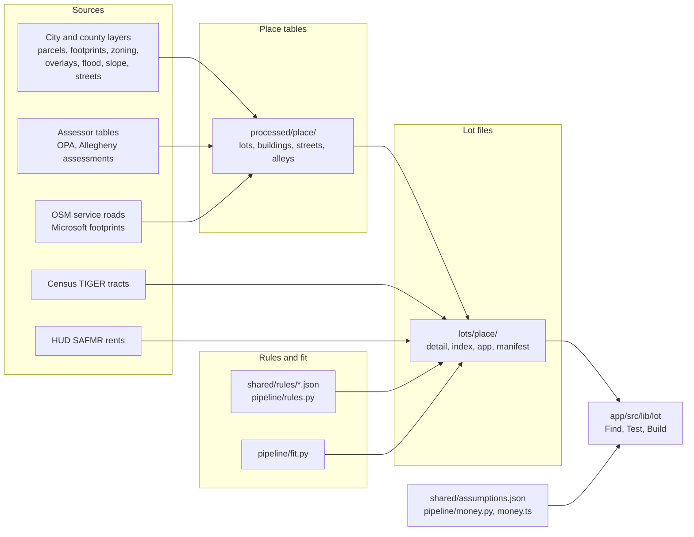

# Architecture

This product answers one question for a home lot in Pennsylvania: can a backyard home (an ADU) go here, how big, under which rules, and does it pay. Philadelphia and Pittsburgh are covered lot by lot.

Not legal advice. Not a zoning determination. Parcel lines are not a survey.

## Three steps for the user

| Step | What the user does | What answers it |
|---|---|---|
| Find | Search an address or pan the map. Pick a lot. | The lot index and the per-tract lot files (`lots/<place>/index.parquet`, `app/<GEOID>.json`, `detail/<GEOID>.json.gz`) |
| Test | Draw or size a unit. See if it fits, under which scenario, and why not. | The saved lot record (rules, buildable ground, fit per ADU type), checked again in the browser by `app/src/lib/lot/verdict.ts` and `app/src/lib/fitBox.ts` |
| Build | Read the steps from rules to rental license, with fees and the money picture. | `app/src/lib/lot/buildSteps.ts` and the money model (`pipeline/money.py`, `app/src/lib/money.ts`) |

The browser library for these steps is in `app/src/lib/lot/`. It is tested but not wired into the screens yet. See [app/src/lib/lot/README.md](../app/src/lib/lot/README.md) for the list of screen files that still need a change.

## Data flow



In words:

1. Each place module downloads its layers once into `raw/<place>/` and records each one in `raw/<place>/SOURCES.json`.
2. The place `build` step joins parcels, assessor rows, zoning, overlays, flags and building outlines into one lots table and one buildings table per place, in `processed/<place>/`.
3. The lot builder (`pipeline/build_lots.py`) reads those tables. For every lot and each of the three scenarios it resolves the rules (`pipeline/rules.py`), finds the front, rear and side lot lines, cuts the buildable ground and fits each allowed ADU type (`pipeline/fit.py`).
4. It writes one validated JSON record per lot, grouped by 2020 census tract, plus a compact index, the current app's per-tract lists and a manifest.
5. The browser loads a tract file, shows the saved answer, and tests a unit the user draws against the saved buildable ground.

Two image models sit beside this flow. Their outputs are not in the lot records yet:

- The land cover model (`pipeline/vision/`) scores aerial images as other, building, tree and open ground. The lot records carry an empty `cover` block and the note "no land cover yet".
- The object detector (`musa6950/yolo/`) finds garages, sheds, other accessory buildings and pools. It writes `processed/yolo/detections_<city>.parquet`. The lot records carry an empty `objects` list.

## Module map

| Path | Role |
|---|---|
| `pipeline/paths.py` | Data root from `ADU_DATA_DIR`. Folders for raw, processed and logs |
| `pipeline/places/common.py` | ArcGIS downloads with paging and retry, safe table writes, `SOURCES.json`, spatial joins, cutting shared outlines along lot lines |
| `pipeline/places/philadelphia.py` | Philadelphia download, build, check, fit sample run, garage check chips |
| `pipeline/places/pittsburgh.py` | Pittsburgh download, build, check |
| `pipeline/tracts.py` | Downloads the 2020 TIGER tract file for Pennsylvania and tags lots with a tract |
| `shared/rules/*.json` | Cited rule files: one per place, one per bill, a default, and the schema |
| `pipeline/rules.py` | Validates rule files and resolves them for one lot and one scenario |
| `pipeline/fit.py` | Vector fit engine: lot lines, setbacks, buildable ground, largest rectangle, fit per ADU type |
| `pipeline/lot.py`, `pipeline/lot_schema.json` | The lot record contract and its validator |
| `pipeline/build_lots.py` | Lot file builder: `run`, `validate`, `stats`, `qa` |
| `pipeline/market.py` | HUD Small Area Fair Market Rents for Pennsylvania ZIP codes |
| `pipeline/money.py`, `shared/assumptions.json` | Cost, rent and pay-off model. Every number lives in the assumptions file |
| `pipeline/vision/` | Land cover U-Net: labels, training, scoring |
| `musa6950/yolo/` | Object detector. Uses an AGPL library and is kept in its own folder. Only data files leave it |
| `app/src/lib/lot/` | Browser side: load lot files, verdict, citations, build steps, report data, assistant tools |
| `app/src/lib/fitBox.ts` | Does a box fit inside the saved buildable outline (browser) |
| `app/src/lib/money.ts` | Same money model as `pipeline/money.py`, line for line |
| `tests/` | Python tests. Browser tests sit beside each TypeScript file |

## Where data lives

Data stays off the code checkout. One environment variable points at the data root:

```
ADU_DATA_DIR   default ~/musa-drive
```

| Folder under the data root | What is in it |
|---|---|
| `raw/<place>/` | Layers as downloaded (GeoPackage, Parquet) and `SOURCES.json` |
| `raw/tiger/` | `tl_2020_42_tract.zip`, the statewide 2020 tract file |
| `raw/market/` | HUD SAFMR download, Freddie Mac PMMS history, DoD area cost factors |
| `raw/imagery/<city>/` | Detector sample areas, image chips and chip list |
| `processed/<place>/` | `lots.parquet`, `buildings.parquet`, `streets.parquet`, `alleys.parquet` (Philadelphia), `lot_tracts.parquet`, `join_check.json`, `overlay_check.json` (Philadelphia) |
| `processed/market/` | `safmr_pa.parquet` |
| `processed/vision/` | Land cover labels, caches and class shares |
| `processed/yolo/` | Detector dataset, review pack, detections per lot |
| `lots/<place>/` | Lot files: `detail/`, `parts/`, `index.parquet`, `app/`, `manifest.json`, `progress.jsonl`, `errors.jsonl`, `stats.json`, `qa/` |
| `models/` | Land cover runs (one folder per run) and detector runs |
| `ops/logs/` | Run notes |

Some exceptions read other paths:

- `musa6950/yolo/config.py` uses `~/musa-drive` directly, not `ADU_DATA_DIR`.
- `pipeline/vision/data.py` reads its NAIP images and labels from the course checkout (`ADU_VISION_SOURCE`, default `~/Documents/YZ-MUSA-FINAL/data/raw/6950`).

## Coordinates

All lengths and areas are computed in a local state plane in feet: EPSG:2272 for Philadelphia, EPSG:2271 for Pittsburgh. Lot records store geometry as GeoJSON in WGS84 for the map, and name the local system in `lot.crs_local`.

## Ids

A lot id is the county FIPS code, a dash, and the county parcel id. Philadelphia uses the 9 digit OPA account (`42101-051151530`). Pittsburgh uses the county parcel id (`42003-0001D00128000000`). Ids never clash across places.

## Safe writes

Tables that other jobs may read are written under a temporary name, the old file is kept as `<name>.prev.parquet`, and one rename swaps them. A stopped run never leaves half a file. The lot builder records each finished tract in `progress.jsonl` and skips it on the next run.

## Related documents

- [DATA.md](DATA.md): every data set
- [METHODS.md](METHODS.md): how the fit, rules, models and money work
- [RULES.md](RULES.md): what the rule files say today
- [RUNNING.md](RUNNING.md): commands
- [ADDING_A_CITY.md](ADDING_A_CITY.md): the recipe for a new place
- [LICENSES.md](LICENSES.md): terms for data, models and libraries
