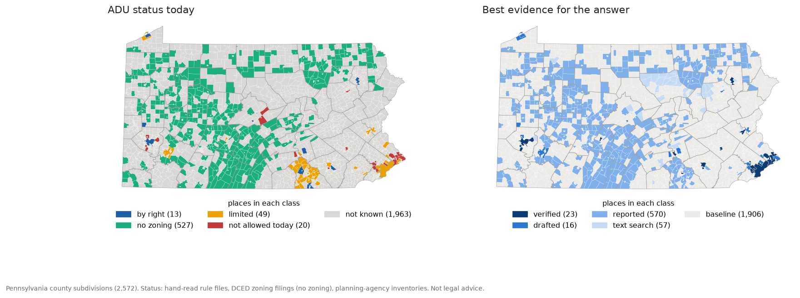
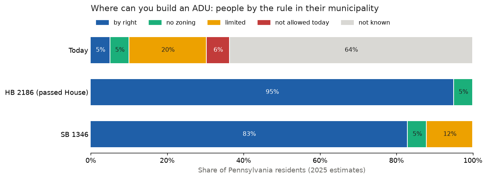
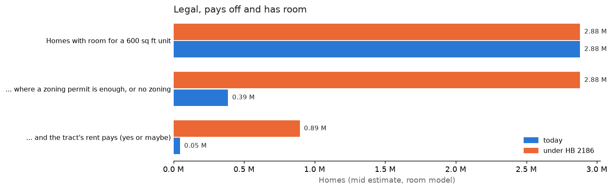

# Draft section for results.md: every municipality

Draft for the director. Not in the site render list. Numbers from `<data root>/processed/5500/places_summary.json`
(built by `python -m pipeline.places_index analyze`). Paste as section 10 of results.md if adopted.

### 10. Every municipality: where can you build an ADU today?

<!-- source: ~/musa-drive/processed/5500/places_by_status.csv, places_by_tier.csv, places_scenarios.csv, places_summary.json; app/public/data/pa_places.json -->

Sections 8 and 9 read the rules of 38 places by hand. Pennsylvania has 2,560 municipalities, each with its own zoning
or none. To see the whole pattern, every county subdivision now gets one answer, the evidence tier behind it, and a
dated source (docs/PLACES.md):

- Hand-read rule files (verified or drafted) for the 38 places.
- The state's record of which municipalities have no zoning at all (PA DCED Municipal Statistics, from the annual
  filing every municipality makes, exported 2026-11-12). Where there is no zoning, zoning does not limit an ADU. The
  building code and sewage permits still apply.
- Planning-agency ADU inventories, where an open and dated one exists (shown as "reported", never as verified).
- Searchable public zoning text (no answer claimed), and the statewide baseline for the rest.

**People by the ADU rule where they live (2025 estimates, 13.06 million residents)**

| ADU status today | Places | Residents | Share |
|---|---|---|---|
| By right | 13 | 670,560 | 5.1% |
| No zoning | 527 | 648,621 | 5.0% |
| Limited (family only, hearing, conversion only, owner rule) | 49 | 2,643,226 | 20.2% |
| Not allowed today (no ADU text, or banned) | 20 | 790,317 | 6.1% |
| Not known | 1,963 | 8,307,293 | 63.6% |

- One in five municipalities (527) has no zoning ordinance. They hold only 5% of the people, mostly in the rural
  northern tier, the west-central counties and the ridge-and-valley counties of the south. Here an ADU is already free of zoning, so a state ADU bill changes nothing.
- Where the rule is known (36% of the people), "by right" is rare: 5.1% of residents. The largest group is
  "limited" (20%), led by Philadelphia's conversion-only rule, the family-only rules of the suburban townships and
  the York County townships where an elder cottage or an ADU needs a hearing.
- Only one county planning agency (York) publishes a full municipal table that shows ADU permissions. Elsewhere the
  inventories are a few examples, some from 2005.
- Nearly two thirds of the people live where the town's ADU rule is still not known to this project. Most large places put
  their code only on commercial code hosts whose terms bar automated reading, so the gap closes only by hand.

**The bills**

- HB 2186 (passed the House 139-62, in the Senate committee) would make one ADU by right in every municipality with
  zoning, Philadelphia and Pittsburgh included. Every resident would then live where zoning allows an ADU by right
  (95%) or does not apply (5%).
- SB 1346 amends the Municipalities Planning Code, which does not govern Philadelphia or Pittsburgh. 88% of residents
  would be covered. Philadelphia (12%) keeps its conversion-only rule. Pittsburgh is already by right.

**Legal, pays off, and has room**

<!-- source: places_legal_pays_room.csv; tract to town shares from pipeline/tract/forecast.town_split (LODES block weights); room_tract.csv lots_room_mid; payoff_tract.csv pays -->

| Homes with room for a 600 sq ft unit (mid) | Today | Under HB 2186 |
|---|---|---|
| All | 2.88 M | 2.88 M |
| ... where a zoning permit is enough, or there is no zoning | 0.39 M (13.4%) | 2.88 M (100%) |
| ... and the tract's rent pays (yes or maybe, section 4) | 45,000 (1.6%) | 894,000 (31%) |

- Today only about 45,000 homes with room sit where a permit is enough and the rent pays (low to high 28,000 to
  57,000). Under HB 2186 that becomes about 894,000 (443,000 to 1.19 million), about 20 times more.
- "Today" counts only places whose rule is known. The 64% of people in "not known" places are left out of the legal
  count, so today's number is a floor, not an estimate.

**What it would do to the 2031 forecast (not adopted)**

<!-- source: ~/musa-drive/processed/5500/forecast_places_alt.csv and forecast_places_alt.json -->

A separate run used the same tract inputs as section 6 and changed only the town classes: the 527 no-zoning places
count as by right (nothing in zoning holds an ADU back there), and the 43 places with a dated inventory status take
that status. The run first rebuilds the saved forecast exactly from the saved inputs, so the difference is only the
classes.

| ADUs by 2031, mid | Section 6 (saved) | No-zoning places only | Full places table |
|---|---|---|---|
| Today's rules | 1,012 | 1,399 (+387) | 1,463 (+451) |
| HB 2186 | 13,455 | 13,455 | 13,455 |
| SB 1346 | 13,238 | 13,238 | 13,238 |

- The bills' totals do not move, because under a bill every place already counts as by right.
- Today's total rises by 45%, mostly from no-zoning places. The bill effect (today to HB 2186) shrinks from about
  13 times to about 9 times. The director decides whether to adopt this.

Not legal advice. Not a zoning determination. Check with the municipality before you plan a unit.
