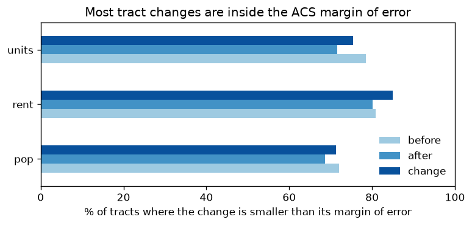
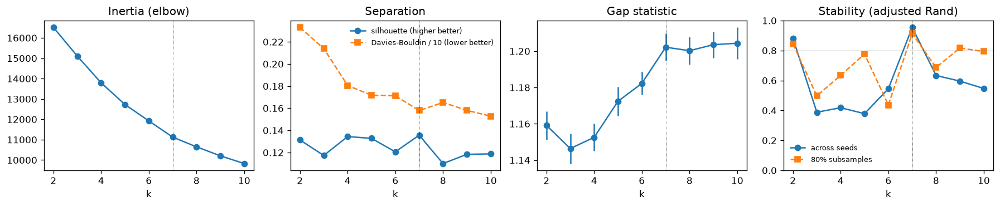
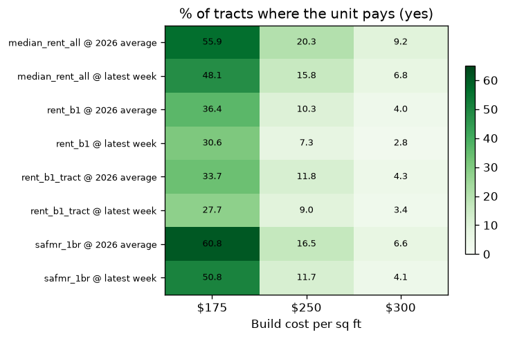
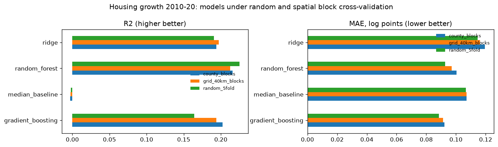
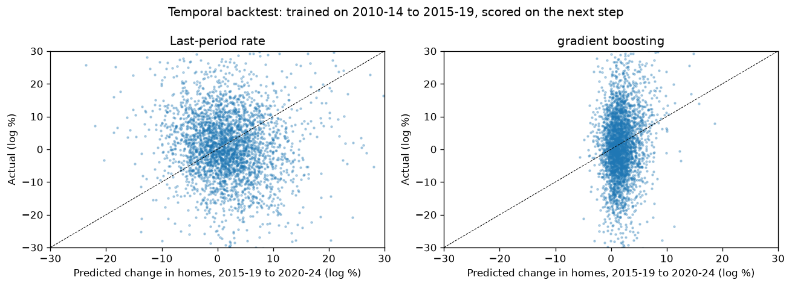
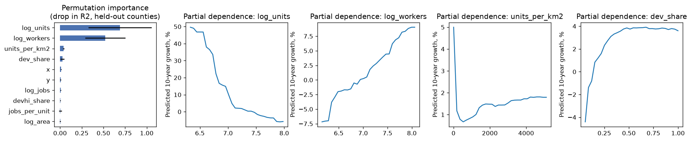
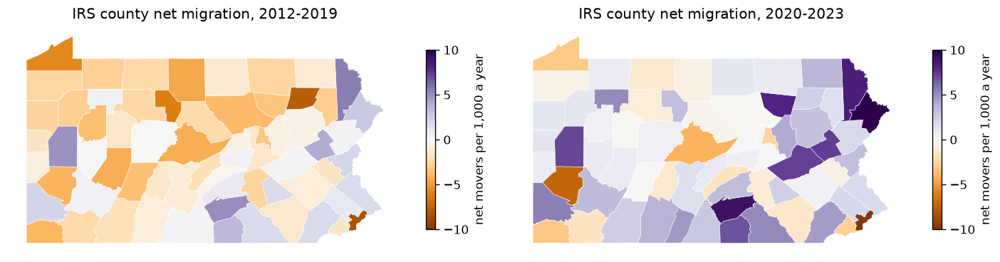
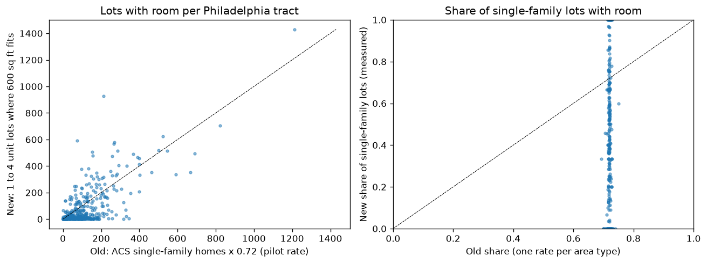
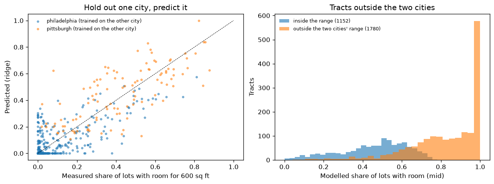

Every number below comes from the modules in `pipeline/tract/` as run by the executed notebooks in `musa5500/notebooks/`. The tables they write are in `data/processed/` and `processed/5500/` on the data drive.

## Introduction

- HB 2186 would allow an ADU (backyard home) on every home lot in Pennsylvania. SB 1346 would do the same outside Philadelphia and Pittsburgh. Both die on Nov 30, 2026 if not enacted
- Legal does not mean built. Philadelphia has allowed ADUs in parts of the city since 2012 and only about 10 were built legally
- This half of the project asks four things
  - Where are people and jobs growing?
  - Did that change after 2019?
  - Where would a new ADU pay for itself?
  - How many ADUs could be built by 2031, under today's rules and under the state bills?
- Unit: 2020 census tracts (3,445) and towns (2,572 county subdivisions)

## What changed since the first draft

- **One payoff number.** The first draft priced a 600 sq ft unit with the all-unit tract median rent and found 20.3% of tracts pay. The tool used a 1-bedroom rent and showed 10.3%. A 600 sq ft unit is a 1-bedroom, so the 1-bedroom rent is the honest basis. The report now uses the tool's column. The answer is 10.3% of tracts. The all-unit number is kept as a cross-check
- **Trend groups.** The first draft used K-means with k = 5. Rerun with 20 seeds, k = 5 gives different groups each time (adjusted Rand 0.38). The new rule picks k = 7, which is stable (0.95). All k have weak structure, so the groups are now called a description, not a finding
- **Forecast.** The model is compared with a baseline, ridge and gradient boosting, under county and grid block cross-validation, with a temporal backtest and 90% intervals. Gradient boosting has the lowest held-out error and replaces the random forest. The ADU totals fall because fewer tracts pass the payoff test
- **ACS windows.** "Before" and "after" now say which 5-year windows they compare. Tract changes smaller than their margin of error are flagged
- **IRS migration** was downloaded but unused. It is now tested as a model feature (no gain, so not kept) and shown as a context map
- **Lots with room.** The forecast used the retired raster pilot: one fit rate per area type times ACS single-family homes. It now uses the lot tool's vector results in Philadelphia and Pittsburgh (measured, every 1 to 4 unit lot) and a model trained on them everywhere else, with a range (section 9)
- **Town rules.** The 12-town list is replaced by the town rule files: 38 municipalities with a rule file, each mapped to a legal class. Every other town is "unknown" (section 9)

## Methods (short)

Full detail is in [methods](methods.md). In short:

- Growth: ACS 2010-14, 2015-19 and 2020-24 on 2020 tracts (block crosswalk), dollars in 2024 terms (CPI-U), margins of error from the Census summary files. Jobs from LODES
- Groups: six growth rates, standardized. k from 2 to 10 scored by silhouette, Davies-Bouldin, gap and stability. K-means vs Gaussian mixture vs Ward
- Payoff: 600 sq ft 1-bedroom unit, $175 / $250 / $300 per sq ft plus 15%, all borrowed for 30 years at 6.53%, 30% of rent to running costs
- Forecast: housing growth 2010-20 by tract, models scored with spatial block CV and a temporal backtest. ADUs by 2031 = people x permit rate x payoff x lots x demand x town rule

## Results

### 1. Growth before and after 2019

Notebook `01_trends`. Statewide, from summed tract counts. Yearly rates in %.

- ACS before = 2010-14 to 2015-19 (midpoints 2012 to 2017). ACS after = 2015-19 to 2020-24 (midpoints 2017 to 2022). The "after" step starts two years before 2019
- Jobs before = 2010 to 2019. Jobs after = 2019 to 2024

<!-- source: ~/musa-drive/processed/5500/growth_summary.json -->
| Measure | Before | After | Change |
|---|---|---|---|
| Population (ACS) | 0.05 | 0.35 | +0.30 |
| Housing units (ACS) | 0.41 | 0.39 | -0.01 |
| Jobs (LODES) | 0.95 | 0.31 | -0.64 |
| Real rent, median tract | 0.76 | 0.41 | -0.35 |

- Job growth slowed the most
- Population looks like it sped up. Part of this is not real. The 2020-24 ACS is weighted to post-2020 census estimates, which came in higher than the 2010s estimates
- Housing growth held flat at about 0.4% a year
- Share of tracts that sped up: population 54%, homes 48%, jobs 42%, rent 43%

Inflation. Median tract values, nominal and in 2024 dollars:

<!-- source: musa5500/notebooks/01_trends.ipynb (executed) -->
| Measure | 2010-14 nominal | 2015-19 nominal | 2020-24 nominal | 2010-14 real | 2015-19 real | 2020-24 real |
|---|---|---|---|---|---|---|
| Gross rent | $820 | $917 | $1,149 | $1,087 | $1,125 | $1,149 |
| Home value | $153,000 | $163,400 | $230,200 | $202,734 | $200,490 | $230,200 |
| Household income | $52,083 | $60,016 | $74,844 | $69,013 | $73,639 | $74,844 |

- Nominal rent rose 40% from the first window to the last. Real rent rose 6%

Margins of error. Share of tracts whose change is smaller than its 90% margin:

<!-- source: ~/musa-drive/processed/5500/growth_summary.json (moe) -->
| Measure | Before | After | Change in trend |
|---|---|---|---|
| Population | 72.0% | 68.6% | 71.4% |
| Housing units | 78.5% | 71.6% | 75.4% |
| Median rent | 80.9% | 80.1% | 84.9% |

- Most single-tract changes cannot be told apart from no change. Statewide sums and group medians are much firmer than any one tract
- The flags are in `trends_tract.csv` so the tool can say when a tract number is within the noise

### 2. Trend groups

Notebook `02_groups`. 3,163 tracts have all six rates. 282 do not (tiny bases or no rent data) and are labeled "Not enough data".

How many groups? K-means for k = 2 to 10:

<!-- source: ~/musa-drive/processed/5500/groups_k_metrics.csv -->
| k | Silhouette | Davies-Bouldin | Gap | ARI across seeds | ARI on 80% subsamples | Smallest group |
|---|---|---|---|---|---|---|
| 2 | 0.131 | 2.33 | 1.159 | 0.88 | 0.85 | 46.7% |
| 3 | 0.117 | 2.14 | 1.146 | 0.39 | 0.50 | 30.5% |
| 4 | 0.134 | 1.81 | 1.153 | 0.42 | 0.63 | 3.2% |
| 5 | 0.133 | 1.72 | 1.172 | 0.38 | 0.78 | 3.1% |
| 6 | 0.121 | 1.71 | 1.182 | 0.55 | 0.44 | 2.9% |
| 7 | 0.136 | 1.58 | 1.202 | 0.95 | 0.91 | 2.9% |
| 8 | 0.110 | 1.65 | 1.200 | 0.63 | 0.69 | 2.9% |
| 9 | 0.118 | 1.58 | 1.204 | 0.60 | 0.82 | 2.7% |
| 10 | 0.119 | 1.53 | 1.204 | 0.55 | 0.79 | 2.7% |

- Silhouette stays between 0.11 and 0.14 for every k. Values this low mean the groups overlap a lot. The elbow has no bend and the gap statistic has no clear peak
- Only k = 2, 7 and 9 are stable (subsample ARI at least 0.8). The rule then takes the best silhouette: k = 7. It also has the second lowest Davies-Bouldin
- The first draft's k = 5 was not stable: K-means runs with different seeds agree only 0.38 on average (ARI)

Three methods at k = 7:

<!-- source: ~/musa-drive/processed/5500/groups_methods.csv -->
| Method | Silhouette | Davies-Bouldin | ARI with K-means |
|---|---|---|---|
| K-means | 0.136 | 1.58 | 1.00 |
| Gaussian mixture | 0.059 | 3.24 | 0.24 |
| Ward | 0.085 | 1.88 | 0.20 |

- The three methods split the tracts very differently (ARI 0.16 to 0.24). If the data had real clusters, they would agree
- K-means is kept because it scores best and is stable. But the honest reading is that Pennsylvania tracts form a smooth spread of growth paths. The groups below summarize that spread. They are not a discovery

Median yearly growth in each group (%):

<!-- source: ~/musa-drive/processed/5500/groups_profile.csv -->
| Group | Tracts | Jobs before | Jobs after | People before | People after | Rent before | Rent after |
|---|---|---|---|---|---|---|---|
| Steady: close to the state median | 1,001 | -0.40 | -0.76 | -0.63 | 0.31 | 0.47 | -0.02 |
| Steady: people grew fast before 2019 | 490 | 0.65 | -0.15 | 2.04 | -0.84 | 1.49 | 0.81 |
| Steady: rents rose fast after 2019 | 478 | 1.11 | 0.54 | -0.11 | 0.45 | -2.27 | 4.78 |
| Shrinking: jobs grew fast before 2019 | 433 | 6.83 | -0.99 | 0.07 | -0.15 | 0.57 | -0.03 |
| Steady: rents rose fast before 2019 | 404 | 1.11 | 0.28 | -0.04 | 0.28 | 4.34 | -3.68 |
| Growing: jobs jumped after 2019 | 265 | -1.35 | 8.50 | -0.27 | 0.10 | 0.82 | 1.02 |
| Growing: population jump after 2019 | 92 | 1.93 | 0.65 | 0.41 | 15.72 | 1.27 | 0.72 |

- Most groups are defined by one measure that stands out. The largest group is the middle of the spread
- "Steady: rents rose fast after 2019" (478 tracts) is the group to watch for ADUs. Real rent fell before and rose 4.8% a year after. But only 41% of its tracts have a rent change bigger than the margin of error
- "Growing: population jump after 2019" is small. All 92 tracts have a population change bigger than the margin of error, so the jump is measured. Some of it may still come from the crosswalk, which can put people in the wrong 2020 tract when an old tract was split
- The groups are spread across the state, not in neat regions

### 3. Land and job access

Notebook `03_land_access`.

Developed land (NLCD, all 3,445 tracts):

<!-- source: musa5500/notebooks/03_land_access.ipynb (executed) -->
| Year | Developed km2 | Share of PA land |
|---|---|---|
| 2010 | 16,745 | 14.42% |
| 2019 | 17,374 | 14.97% |
| 2025 | 17,812 | 15.34% |

- PA added about 1,070 km2 of developed land from 2010 to 2025
- 72% of tracts had more developed land in 2025 than in 2010
- The median tract changed only 0.4 points. Most change is in a few edge-of-suburb tracts. The top 10 gains (14 to 41 points) are in Cumberland, York, Northampton, Montgomery, Luzerne, Butler, and Dauphin counties. Three of the top five are in Cumberland County
- The first 2019 mosaic had two empty tiles. They were downloaded again and pasted in. Details are in notebook 03

Jobs within 30 minutes by car (OSMnx, LODES 2024 jobs):

- Philadelphia (408 tracts): the median tract reaches 1,407,502 jobs in 30 minutes. The range is 1,071,537 to 1,521,510
- That is 90% of the jobs in the network area (Philadelphia plus 15 km, inside PA) for the median tract. The lowest tract reaches 69%
- Center City and North Philadelphia reach the most. The far south and far northeast reach the least
- Harrisburg was planned too but the public Overpass server was down or full for hours on the run day. It was skipped. The notebook adds it when rerun
- These are free-flow speeds and miss New Jersey jobs, so they are upper bounds inside PA and lower bounds overall
- Job access was not used in the forecast, because it only covers one city

### 4. Where an ADU pays off

Notebook `04_payoff_forecast`. 600 sq ft 1-bedroom unit, 15% soft costs, all borrowed over 30 years at 6.53% (2026 PMMS average).

<!-- source: ~/musa-drive/processed/5500/payoff_summary.json -->
| Build cost | Total | Monthly payment | Rent needed |
|---|---|---|---|
| Low, $175 / sq ft | $120,750 | $766 | $1,094 |
| Mid, $250 / sq ft | $172,500 | $1,094 | $1,562 |
| High, $300 / sq ft | $207,000 | $1,312 | $1,875 |

- "Rent needed" covers the payment after 30% for vacancy, repairs, tax and insurance
- Rent = 1-bedroom rent for the tract (ACS 2020-24, B25031 county ratio applied to the tract median). Every tract has one

Result for all 3,445 tracts:

<!-- source: ~/musa-drive/processed/5500/payoff_summary.json -->
| Pays | Tracts | Share of tracts | Share of people |
|---|---|---|---|
| yes | 356 | 10.3% | 11.6% |
| maybe | 897 | 26.0% | 28.5% |
| no | 2,192 | 63.6% | 59.9% |

- **An ADU pays at the mid cost in about one tract in ten.** This is the number the tool shows
- The tracts that pay are in the Philadelphia suburbs and parts of the city. Chester has the highest share (67 of 124 tracts). Montgomery has the most (76 of 219), then Philadelphia (73 of 408), Bucks (48 of 147) and Delaware (29 of 152). Allegheny has 22 of 394

Rent bases compared:

<!-- source: ~/musa-drive/processed/5500/payoff_bases.csv -->
| Rent basis | Tracts | Median | vs headline (median ratio) | Correlation with headline |
|---|---|---|---|---|
| 1-bedroom, tract x county ratio (headline, the tool) | 3,445 | $956 | 1.00 | 1.00 |
| 1-bedroom, raw tract B25031 | 2,146 | $906 | 1.04 | 0.88 |
| 1-bedroom, HUD SAFMR FY2026 by ZIP | 3,445 | $1,178 | 1.25 | 0.78 |
| All units, tract B25064 (first draft) | 3,261 | $1,149 | 1.22 | 0.99 |

- The all-unit median is about 18% above the 1-bedroom rent. That is the whole gap between 20.3% and 10.3%
- HUD SAFMRs are higher because they track recent movers, while ACS medians include long-time tenants. A new unit would rent to a new tenant, so the SAFMR answer (16.5%) is a fair upper check on the headline

Sensitivity. Share of tracts where the unit pays (yes), in %:

<!-- source: ~/musa-drive/processed/5500/payoff_sensitivity.csv -->
| Rent basis | Rate | $175 | $250 | $300 |
|---|---|---|---|---|
| 1-bedroom (headline) | 6.53% | 36.4 | **10.3** | 4.0 |
| 1-bedroom (headline) | 7.18% | 30.6 | 7.3 | 2.8 |
| 1-bedroom, raw tract | 6.53% | 33.7 | 11.8 | 4.3 |
| 1-bedroom, raw tract | 7.18% | 27.7 | 9.0 | 3.4 |
| 1-bedroom, SAFMR | 6.53% | 60.8 | 16.5 | 6.6 |
| 1-bedroom, SAFMR | 7.18% | 50.8 | 11.7 | 4.1 |
| All units | 6.53% | 55.9 | 20.3 | 9.2 |
| All units | 7.18% | 48.1 | 15.8 | 6.8 |

- Build cost moves the answer the most. Going from $250 to $175 per sq ft takes the headline from 10.3% to 36.4%
- The rate matters less. At the latest weekly rate (7.18%) the headline falls to 7.3%
- Cheaper building (prefab, smaller units, lower fees) may matter as much as the zoning change

### 5. Where did housing grow? The model

- Target: log of decennial homes 2020 / 2010, crosswalked. 3,394 tracts. The median tract grew 1.31% over the decade
- Features from 2010 only. Five folds in each scheme

<!-- source: ~/musa-drive/processed/5500/forecast_cv.csv -->
| CV scheme | Model | R2 | MAE (log points) | R2, mean of folds |
|---|---|---|---|---|
| Random 5-fold | random forest | 0.225 | 0.093 | |
| Random 5-fold | gradient boosting | 0.164 | 0.088 | |
| Counties held out | median baseline | -0.003 | 0.107 | -0.008 |
| Counties held out | ridge | 0.194 | 0.120 | 0.214 |
| Counties held out | random forest | 0.216 | 0.100 | 0.202 |
| Counties held out | **gradient boosting** | 0.202 | **0.092** | 0.256 |
| 40 km blocks held out | median baseline | -0.002 | 0.107 | -0.007 |
| 40 km blocks held out | ridge | 0.197 | 0.116 | 0.205 |
| 40 km blocks held out | random forest | 0.212 | 0.097 | 0.202 |
| 40 km blocks held out | gradient boosting | 0.194 | 0.091 | 0.233 |

- All three models beat the baseline by about 0.2 R2 in places they have not seen. That is real but modest skill. Four fifths of the tract-to-tract spread is left unexplained
- Gradient boosting has the lowest held-out error (MAE 0.092) and is used. The random forest has a slightly higher pooled R2. The ranking of tracts is close either way
- Random CV flatters the random forest (0.225 vs 0.216 with counties held out). Grid blocks give the same picture as counties

Temporal backtest. Trained on the change from 2010-14 to 2015-19, scored on the change from 2015-19 to 2020-24 (ACS homes, 3,385 tracts with at least 100 homes):

<!-- source: ~/musa-drive/processed/5500/forecast_backtest.csv -->
| Model | R2 | MAE | Correlation | R2 where the change beats its margin (958 tracts) |
|---|---|---|---|---|
| Earlier median | -0.002 | 0.120 | 0.00 | -0.009 |
| Last-period rate | -0.086 | 0.133 | 0.01 | -0.043 |
| Ridge | 0.025 | 0.117 | 0.19 | 0.020 |
| Random forest | 0.019 | 0.118 | 0.14 | 0.019 |
| Gradient boosting | 0.021 | 0.118 | 0.15 | 0.020 |

- **Five years ahead, nothing predicts the ACS tract change well.** A tract's own earlier change says nothing about its next one (correlation 0.01)
- Models add a little (correlation 0.15 to 0.19) but explain only about 2% of the spread
- Part of this is noise: 72% of tract changes in homes are inside the ACS margin of error. The 10-year decennial target above is much cleaner, which is why the model trains on it

Prediction intervals (90%, split conformal on county-held-out errors, `forecast_conformal.csv` and `forecast_summary.json`):

- Half-width 0.204 log points. A tract predicted to grow 5% over ten years gets an interval of about -14% to +29%
- Coverage by held-out county fold: 0.85, 0.93, 0.95, 0.86, 0.92 (mean 0.90)
- Quantile gradient boosting gives narrower bands but covers only 76% of held-out tracts. The conformal bands are honest, and wide

What drives the prediction (permutation importance on held-out counties, drop in R2):

<!-- source: ~/musa-drive/processed/5500/forecast_importance.csv -->
| Feature | Importance | Spread across folds |
|---|---|---|
| Homes in 2010 (log) | 0.691 | 0.364 |
| Workers living in the tract 2010 (log) | 0.522 | 0.231 |
| Homes per km2 | 0.041 | 0.009 |
| Developed share of land | 0.028 | 0.023 |

- Small tracts are predicted to grow faster, and tracts with more workers per home grow faster. Growth is low in tracts with little developed land
- The size effect is partly real (new subdivisions start small) and partly the land-area crosswalk, which is roughest in small tracts

IRS migration:

- Net movers per 1,000 residents a year: the median county went from -1.3 (2012-19) to +1.1 (2020-23). Counties gaining movers went from 22 to 47 of 67
- As a model feature it adds 0.006 to the held-out R2 (rule: at least 0.02), so it is left out. It stays as context

### 6. ADUs by 2031

- Lots with room: `room_tract.csv`, all 3,445 tracts. Measured lot by lot in Philadelphia and Pittsburgh (76,970 lots with room), modelled elsewhere (section 9). The old pilot estimate (2,586,637 lots) is kept beside it
- Today's rules: legal classes from the town rule files (section 9). 38 municipalities have a rule file. The other towns count as "unknown" and keep the old "limited" factor
- Forecast covers 2,571 of 2,572 towns. Wheatland borough (Mercer) has no blocks in the LODES crosswalk and no population estimate after 2019

Statewide ADUs, 2027 to 2031:

<!-- source: ~/musa-drive/processed/5500/forecast_summary.json, forecast_totals.csv -->
| Scenario | Low | Mid | High | Mid per year | Mid per 100k people per year |
|---|---|---|---|---|---|
| Today's rules | 314 | 1,012 | 2,451 | 202 | 1.6 |
| HB 2186 | 6,540 | 13,455 | 20,367 | 2,691 | 20.7 |
| SB 1346 | 6,431 | 13,238 | 20,056 | 2,648 | 20.3 |

Old vs new inputs (mid, by 2031):

<!-- source: ~/musa-drive/processed/5500/forecast_old_vs_new.csv -->
| Inputs | Today | HB 2186 | SB 1346 |
|---|---|---|---|
| Old: pilot room, 12-town list | 896 | 13,144 | 12,839 |
| New room, 12-town list | 868 | 13,455 | 13,238 |
| Pilot room, rule-file classes | 1,046 | 13,144 | 12,839 |
| New: new room, rule-file classes | 1,012 | 13,455 | 13,238 |

- **New room** adds about 310 under HB 2186 and 400 under SB 1346, and takes about 30 from today. The lots index is relative to the state ratio, so better room data moves ADUs between places more than it changes the total. The two cities fall (Philadelphia 321 to 228 under HB 2186, Pittsburgh 166 to 124), because their measured room is far below the old pilot rate. Suburban and rural tracts gain a little weight
- **Rule-file classes** add about 150 today and change nothing under the bills, where every town is by right. Seven by-right towns gain (Lower Paxton 81, Cranberry 55, Erie 31, Scranton 26, Altoona 17, State College 14, Harrisburg 10 mid). The 18 towns with no ADU text or a ban drop to near zero. West Vincent and College township were "allowed" in the old list but have no rule file yet, so they are now "unknown"
- The low to high range comes from the permit rate (26 to 81 per 100,000) and the rule factors. It shows the assumptions, not statistical error. The room range (section 9) is not carried into these totals. They use the mid room estimate
- **This is scenario arithmetic, not a fitted forecast. ADU permit data is thin.** The Census permit survey does not count ADUs on their own, and Pennsylvania has no ADU permit series. So the scenario cannot be fit or tested against real ADU counts. The model in section 5 only ranks where housing grows. Treat the totals as "what the stated assumptions imply"
- The cities the permit rate comes from would give PA 3,385 to 10,545 a year (26 and 81 per 100,000 times 13,018,639 people, `forecast_summary.json`). The HB 2186 mid case (2,691 a year) is below that range, because most tracts fail the payoff test and many have few lots with room
- HB 2186 mid is about 8.9% of the new homes PA permits each year now (24,810 to 47,894 a year in 2021-2025)
- Under today's rules the mid case is about 13 times smaller. 11,297 of the 13,455 HB 2186 mid comes from the towns with no rule file. Reading more town codes would change "today" the most
- SB 1346 is close to HB 2186 because it reaches every town but the two big cities. Philadelphia stays at 11 mid under SB 1346 vs 228 under HB 2186

Mid ADUs by 2031, by the town's legal class today:

<!-- source: ~/musa-drive/processed/5500/forecast_by_rule_today.csv -->
| Legal class | Rule file? | Today | HB 2186 | SB 1346 |
|---|---|---|---|---|
| by right | yes | 404 | 404 | 404 |
| conversion only | yes | 12 | 237 | 20 |
| discretionary | yes | 3 | 69 | 69 |
| family only | yes | 23 | 465 | 465 |
| none | yes | 5 | 983 | 983 |
| unknown | no | 565 | 11,297 | 11,297 |

Top towns under HB 2186 (mid):

<!-- source: data/processed/forecast_town.csv -->
| Town | Class today | Rule file | People | Low | Mid | High | Today, mid |
|---|---|---|---|---|---|---|---|
| Philadelphia city | conversion only | verified | 1,579,706 | 110.6 | 227.7 | 344.7 | 11.4 |
| Northampton township | none | verified | 39,920 | 64.5 | 132.8 | 201.1 | 0.7 |
| Pittsburgh city | by right | verified | 304,759 | 60.2 | 123.5 | 185.9 | 123.5 |
| Lower Merion township | family only | verified | 64,174 | 55.0 | 113.2 | 171.3 | 5.7 |
| Haverford township | none | verified | 50,874 | 49.0 | 100.8 | 152.6 | 0.5 |
| Radnor township | none | drafted | 33,718 | 47.6 | 98.0 | 148.3 | 0.5 |
| Upper Providence township | unknown | none | 24,666 | 44.5 | 91.5 | 138.5 | 4.6 |
| Middletown township (Bucks) | none | verified | 45,793 | 43.9 | 90.3 | 136.7 | 0.5 |
| Lower Makefield township | none | verified | 33,485 | 43.7 | 89.9 | 136.1 | 0.4 |
| Tredyffrin township | unknown | none | 31,922 | 42.1 | 86.6 | 131.1 | 4.3 |

- Philadelphia check. Today's class gives 2 to 35 ADUs by 2031 (11 mid), about 2 a year. The real record is about 10 in 12+ years
- Pittsburgh is 124 of the 1,012 "today" mid case. The bills change nothing there or in the other by-right towns
- Five of the top ten towns under HB 2186 have no ADU text in their code today. The bill would open them

County totals are in `data/processed/county_rollup.csv` (one row per county, sums of tracts).

### 7. Explore the results

[Open the linked view](../figures/tract_explorer.html). Click counties on the map and drag a box on the scatter. The trend groups, the margin histogram and the table of the best tracts follow the selection.

### 8. Why not today: law, yard space and missing town rules

The tract results say where demand and payoff are. They do not say why so few ADUs get built where both look good. The lot tool and the town rule files give the rest of the answer. The limit is different in each place.

**Philadelphia: the law is the limit.**

<!-- source: ~/musa-drive/lots/philadelphia/stats.json all.paths, data version philadelphia-20261111-b7fa7bda07, stats.json written 2026-11-11 22:50 -->

| Philadelphia, 459,998 lots | Today | Local reform (Bill 250042) | State reform (HB 2186) |
|---|---|---|---|
| Any legal ADU path | 1.2% (5,469 lots) | 53.3% (245,114 lots) | 100% |
| Legal path for a new detached unit | 0% | 0% | 100% |
| A detached unit fits the yard | 0% | 0% | 26.0% (119,401 lots) |

- Today almost no lot has a legal path, and no lot can add a new detached unit by right. The bars come from zoning overlays in the code, not from any test of the yard
- 73 of Philadelphia's 408 tracts pass the payoff test (section 4). So demand and payoff exist in the city, and the law stops them first
- Bill 250042 is in committee. It is not law

**Pittsburgh: yard space is the limit.**

<!-- source: ~/musa-drive/lots/pittsburgh/stats.json (all, all.paths) and manifest.json counts, data version pittsburgh-20261111-bdeb5697ae, built 2026-11-11T20:30:22 -->

| Pittsburgh, 92,081 lots | Today | Local reform | State reform (HB 2186) |
|---|---|---|---|
| Any legal ADU path | 100% | 100% | 100% |
| New detached unit by right | 0% | 0% | 100% |
| A detached unit fits the yard (any legal path) | 65.8% (60,559 lots) | 65.8% | 70.0% (64,432 lots) |

- Ordinance 31-2026, signed Oct 29, 2026, allows internal and attached units by right on every lot. A detached unit in a side or rear yard needs an Administrator's Exception. Local reform equals today in Pittsburgh
- So the law opens every lot. What stops a detached unit is the yard. The top reason a detached unit does not fit, or cannot grow, today:

| Top limit today | Share of lots |
|---|---|
| Room in the yard after setbacks (`yard_space`) | 41.4% |
| No room for any unit (`no_room`) | 34.2% |
| The 1,000 sq ft size cap (`size_cap`) | 24.4% |

- Only 22 of Allegheny County's 394 tracts pass the payoff test. In Pittsburgh the yard and the rent both limit what gets built, not the law

**The rest of the state: most large towns have no ADU rule.**

<!-- source: shared/rules/towns_index.json (status, population, pop_rank) and adu.status.value in each shared/rules/pa_*.json, computed -->

The rule files cover the 36 largest municipalities after the two cities (population ranks 3 to 38, 2020 Census). 21 files are verified. 15 are drafted, each with a stated open point. A statewide baseline file covers what applies in every town.

| ADU status in the town code | Towns | Verified | Drafted | People (2020) |
|---|---|---|---|---|
| Not addressed (no ADU text) | 17 | 11 | 6 | 684,436 |
| Allowed by right | 8 | 4 | 4 | 518,164 |
| Family members only | 8 | 3 | 5 | 436,944 |
| Prohibited (Reading) | 1 | 1 | 0 | 95,112 |
| Special exception (Bristol township) | 1 | 1 | 0 | 54,291 |
| Conversion only (York) | 1 | 1 | 0 | 44,800 |
| **Total** | **36** | **21** | **15** | **1,833,747** |

- 17 of the 36 have no ADU text at all, and Reading bans ADUs. So 18 of 36 offer no ADU path in their own code. Another 8 allow a unit only for family
- A town with no ADU text gives no direct path. The usual routes are a variance or a code change (the statewide baseline file cites the Municipalities Planning Code sections). There is no statewide ADU zoning rule today. HB 2186 and SB 1346 would add one. Both bills are pending and not law. The session ends Nov 30, 2026
- The tract forecast (section 6) now reads these files. Towns with no ADU text or a ban count as "none" (near zero today), by-right towns count fully

Not legal advice. Not a zoning determination. Parcel lines are not a survey. Check with the town before you plan a unit.

### 9. Lots with room: measured in two cities, modelled elsewhere

**Measured (lot tool, every 1 to 4 unit lot).**

<!-- source: data/processed/lots_city_v2.csv (pipeline/tract/lot_rollup.py) -->
| | Philadelphia | Pittsburgh |
|---|---|---|
| Lots | 459,998 | 92,081 |
| Any legal path today | 5,469 (1.2%) | 92,081 (100%) |
| Any legal path, local reform | 245,114 (53.3%) | 92,081 (100%) |
| By right today | 5,469 (1.2%) | 92,081 (100%) |
| Detached unit fits today: 400 / 600 / 800 / 1,000 sq ft | 0 / 0 / 0 / 0 | 50,012 / 37,923 / 28,892 / 22,448 |
| Detached unit fits, state reform: 400 / 600 / 800 / 1,000 sq ft | 59,460 / 34,741 / 22,553 / 202 | 54,245 / 42,229 / 32,363 / 25,065 |
| Share with room for 600 sq ft (state-reform setbacks) | 7.6% | 45.9% |
| Garage-size accessory building | 6,874 (1.5%) | 20,958 (22.8%) |
| Garage conversion fits today | 108 | 20,448 |

- Philadelphia has 0 detached fits today because the law bars new detached units, not because no yard has room. Under state reform 7.6% of lots have room for 600 sq ft. Only 202 for 1,000 sq ft, because few rowhouse yards are that big
- Tract and county files: `lots_tract_v2.csv`, `lots_county_v2.csv`

**Old pilot vs new lot results (Philadelphia).**

<!-- source: ~/musa-drive/processed/5500/lots_compare_pilot.json -->
- Lot by lot: 25,367 of the 26,269 pilot lots match a new lot (same parcel, area within 20%). 96% are single-family detached. The raster said a 600 sq ft box fits on 48.6% of them, the vector test on 40.0%. They agree on 79.2%. 14.7% are "yes" in the old test and "no" in the new one, 6.1% the other way
- By tract (385 tracts): the old counts and the new counts of lots with room correlate 0.72, but the new count is lower by 28 lots per tract on average. The old estimate sums to 45,469 lots with room. The new one finds 34,741 among all 1 to 4 unit lots, 14,453 of them single-family
- The shares do not correlate at all (0.04 across 303 tracts with single-family lots). The old share is the same 0.72 almost everywhere (standard deviation 0.005), the new share runs from 0 to 1 (standard deviation 0.32, mean 0.35)
- Why they differ:
  - The old estimate used one fit rate per area type, so it could not tell one Philadelphia tract from another. Its counts track the new ones only because both grow with the number of homes
  - It counted ACS single-family detached homes (63,206 in these tracts). The parcel data calls only 26,949 lots single-family detached. The new count covers every 1 to 4 unit lot
  - The tests differ. The raster test looked for open land in a land cover image. The vector test uses lot lines, setbacks, 10 ft from the house and 5 ft from garages
  - The urban rate (0.72) was higher than the raster's own answer on the matched Philadelphia pilot lots (48.6%)

**Modelled (every other tract).**

<!-- source: ~/musa-drive/processed/5500/room_cross_city.csv, room_block_cv.csv, room_summary.json -->
Share of lots with room for 600 sq ft, predicted for a city the model never saw:

| Held-out city | Model | R2 | MAE | Pooled share, true | Pooled share, predicted |
|---|---|---|---|---|---|
| Philadelphia | lot-weighted mean | -6.23 | 0.376 | 0.076 | 0.459 |
| Philadelphia | old pilot rate | -18.24 | 0.627 | 0.076 | 0.719 |
| Philadelphia | ridge | 0.486 | 0.068 | 0.076 | 0.049 |
| Philadelphia | gradient boosting | 0.004 | 0.122 | 0.076 | 0.150 |
| Pittsburgh | lot-weighted mean | -2.59 | 0.353 | 0.459 | 0.076 |
| Pittsburgh | old pilot rate | -1.83 | 0.310 | 0.459 | 0.719 |
| Pittsburgh | ridge | 0.458 | 0.126 | 0.459 | 0.499 |
| Pittsburgh | gradient boosting | 0.382 | 0.138 | 0.459 | 0.406 |

- Ridge is used. Trained on Pittsburgh alone it gets Philadelphia's overall share about right (4.9% vs 7.6%), and the other way round (49.9% vs 45.9%). Gradient boosting does worse across cities
- Within the cities, 2 km block cross-validation gives ridge R2 0.757 (MAE 0.076) and gradient boosting 0.749 (0.070). The cross-city numbers are the honest ones for the rest of the state
- The old pilot rate (0.72) is far off in both cities
- What drives it: the share of detached single-family homes raises room, the share of attached homes and housing density lower it
- 90% band: plus or minus 0.218 from the cross-city errors, doubled to 0.436 where a tract is outside the two cities' range

Statewide estimate of 1 to 4 unit lots with room for a 600 sq ft unit:

<!-- source: ~/musa-drive/processed/5500/room_summary.json -->
| | Low | Mid | High |
|---|---|---|---|
| All PA (4,482,651 small-building lots) | 1,491,667 | 2,880,242 | 3,550,530 |
| Of which measured (513 city tracts) | 76,970 | 76,970 | 76,970 |
| Old pilot estimate, for comparison | | 2,586,637 | |

| Old area type (modelled tracts) | Tracts | Outside training range | Share with room, low | Mid | High |
|---|---|---|---|---|---|
| Urban | 1,804 | 789 | 0.28 | 0.59 | 0.83 |
| Suburban | 491 | 457 | 0.50 | 0.93 | 0.99 |
| Rural | 637 | 534 | 0.46 | 0.87 | 0.96 |

- **Measured:** the 513 tracts in Philadelphia and Pittsburgh. **Modelled:** the other 2,932 tracts
- 1,780 of the 2,932 modelled tracts (61%) are outside the range of the two cities, almost all suburban and rural ones. Two cities are a thin basis for the state. The model has never seen a rural lot, so the suburban and rural shares are an extrapolation from city neighborhoods with many detached homes. 459 modelled tracts hit the ceiling of 1.0
- The lot count outside the cities is an ACS building count, not a parcel count. In the two cities it runs 9 to 13% above the real count (median tract)

**Legal classes from the town rule files.**

<!-- source: data/processed/town_legal_class.csv, ~/musa-drive/processed/5500/legal_class_coverage.csv. People = ACS 2020-24, split to towns -->
| Legal class | County subdivisions | Of which drafted | People | Share of PA | People in drafted towns |
|---|---|---|---|---|---|
| Unknown (no rule file) | 2,533 | | 9,274,759 | 71.2% | |
| Conversion only (Philadelphia, York) | 2 | 0 | 1,624,644 | 12.5% | 0 |
| By right | 9 | 4 | 823,799 | 6.3% | 223,655 |
| None (no ADU text, or a ban) | 18 | 6 | 781,464 | 6.0% | 214,612 |
| Family only | 9 | 6 | 459,800 | 3.5% | 265,347 |
| Discretionary (Bristol township) | 1 | 0 | 54,173 | 0.4% | 0 |

- The rule files cover 3,743,880 people, 28.8% of PA. Bethlehem spans two counties, so its 38 municipalities are 39 county subdivisions here
- Drafted files hold 703,614 people. Their class may still change

## Conclusion

- Demand: job growth slowed after 2019 across most of PA. Real rent growth slowed too. Most single-tract changes are inside the ACS margin of error, so tract stories need care
- Groups: tracts do not fall into natural clusters. Seven stable K-means groups summarize the spread. One (478 tracts) saw real rents rise fast in the latest five years
- Payoff: a new 600 sq ft 1-bedroom unit pays for itself at $250 / sq ft and 6.53% in about 10% of tracts, mostly around Philadelphia. Build cost matters more than the rent guess or the rate
- Why not today: in Philadelphia the law is the binding limit. In Pittsburgh every lot has a legal path and the yard is the limit. 17 of the 36 largest other towns have no ADU text
- Room: measured lot by lot, 7.6% of Philadelphia lots and 45.9% of Pittsburgh lots have room for a 600 sq ft unit under state-reform setbacks. Elsewhere the model gives about 2.9 million lots with room (1.5 to 3.6 million), and most of that is extrapolation beyond the two cities
- Forecast: housing growth is only modestly predictable (held-out R2 about 0.2 over ten years, about 0.02 over five). Under HB 2186 the stated assumptions give about 13,500 ADUs by 2031 (6,500 to 20,400). Under today's rules, about 1,000, and that number rests on the 71% of people in towns whose code has not been read

## Limits

- ACS tract data is noisy, and the 2020-24 ACS uses a new population base. The population speed-up is partly an artifact
- The 2010 to 2020 crosswalk uses land area, not where people live
- The payoff test is a screen. It uses one cost per sq ft and one share for running costs. The lot-level money model in the tool itemizes cost, rent, taxes and financing
- ACS gross rent is top-coded at $3,501, so the richest tracts tie
- The forecast factors (payoff weights, rule factors, demand range, permit rate) are judgment calls. They are in `shared/assumptions.json` under `tract.forecast`. The permit rate source page still needs to be recorded
- The forecast's legal classes come from 38 municipalities with rule files, 15 of them drafted. 71% of people live in towns that count as "unknown". Reading more town codes would change the "today" numbers the most
- Lots with room are measured only in Philadelphia and Pittsburgh. Everywhere else they come from a model trained on those two cities, and 61% of the other tracts are outside their range. The forecast uses the mid room estimate. The room range is not carried into the ADU totals
