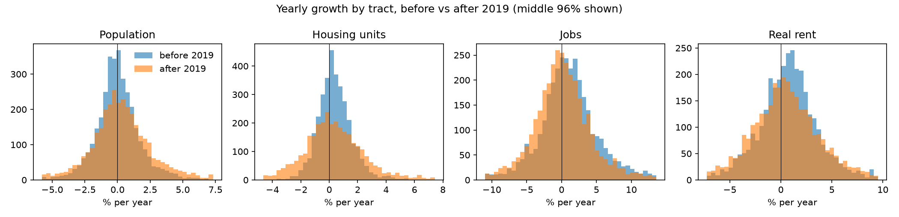
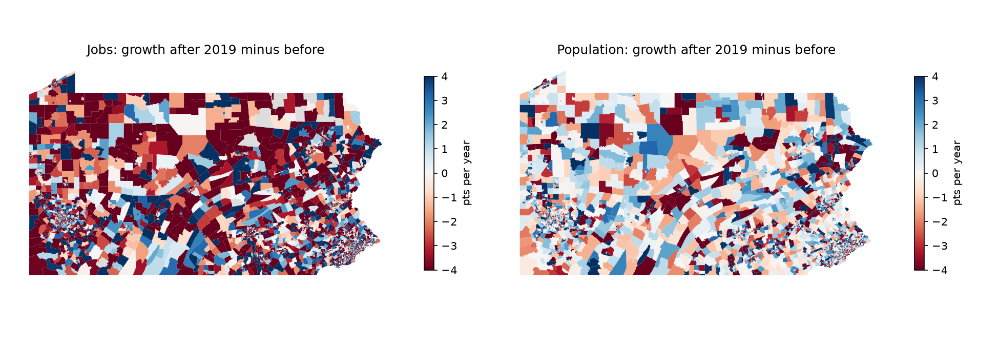
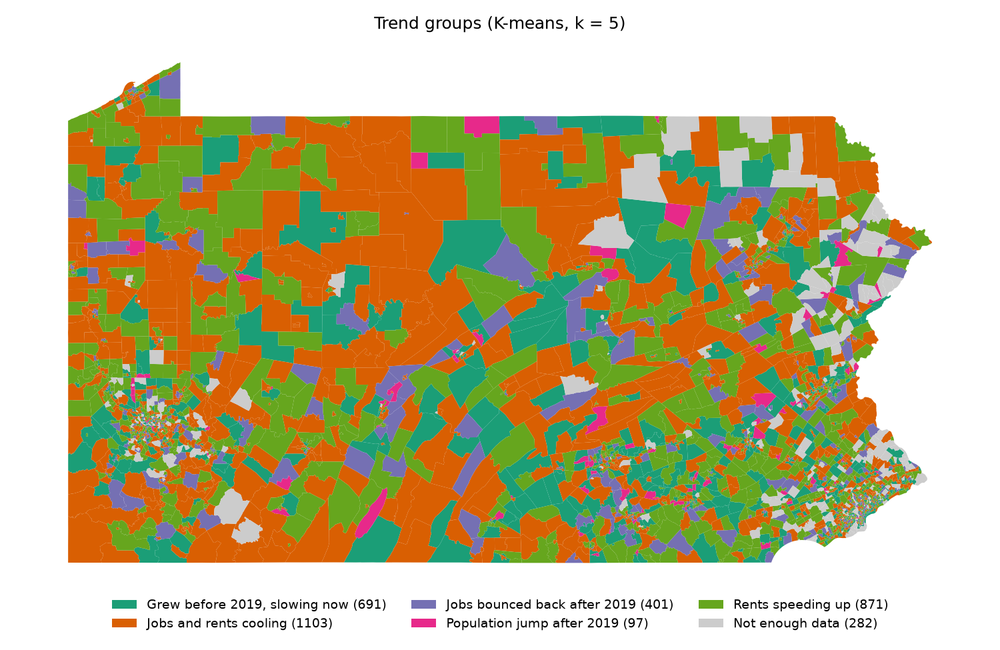
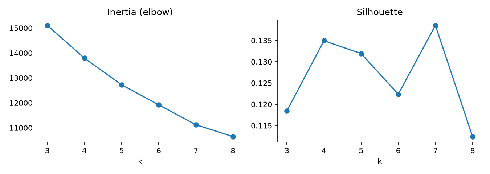
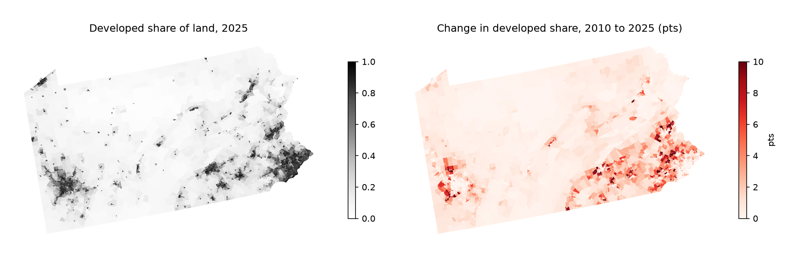
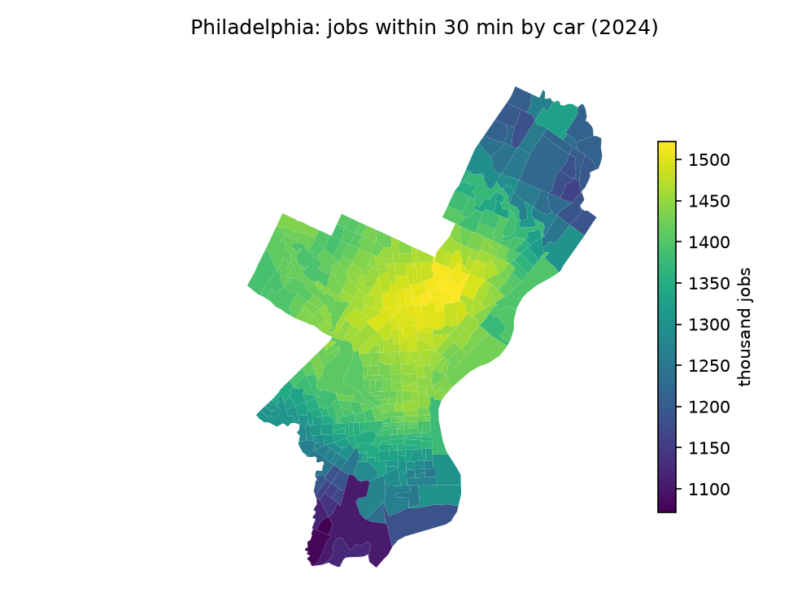
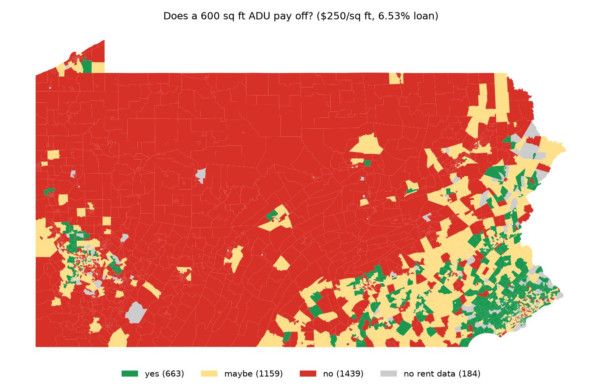
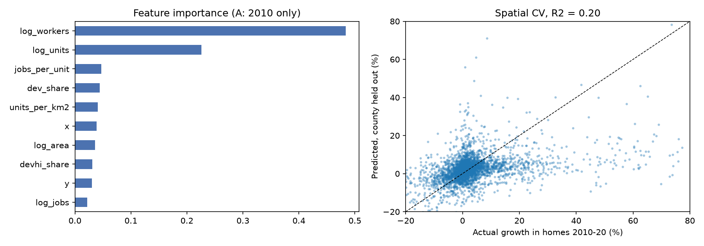
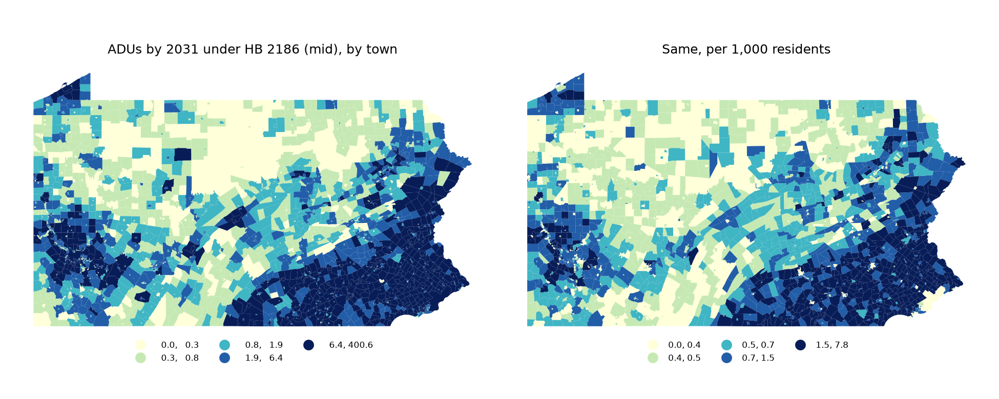

All numbers below come from the executed notebooks in `musa5500/notebooks/`. Notebook names are given with each part so every number can be traced.

## Introduction

- HB 2186 would allow an ADU (backyard home) on every home lot in Pennsylvania
- Legal does not mean built. Philadelphia has allowed ADUs in parts of the city since 2012 and only about 10 were built legally
- This half of the project asks four things
  - Where are people and jobs growing?
  - Did that change after 2019?
  - Where would a new ADU pay for itself?
  - How many ADUs could be built by 2031, under today's rules and under HB 2186?
- Unit: 2020 census tracts (3,445) and towns (2,572 county subdivisions)

## Methods (short)

Full detail is in [methods](methods.md). In short:

- 01: ACS 2010-14 and 2015-19 moved from 2010 to 2020 tracts with the block crosswalk. Counts by land-area share, medians from the biggest-overlap tract. Dollars in 2024 terms (CPI-U). Yearly growth before and after 2019 for people, homes, jobs, and real rent
- 02: K-means on six growth rates (jobs, people, rent, before and after)
- 03: developed share of land per tract from NLCD 2010, 2019, 2025 (zonal stats). Jobs within 30 minutes by car with OSMnx (Philadelphia. Harrisburg could not be downloaded)
- 04: rent vs cost test for a 600 sq ft ADU. Random forest for housing growth 2010-2020 with spatial cross-validation. ADUs by 2031 per town, scaled from the Pew range of 26 to 81 ADU permits per 100,000 people per year

## Results

### 1. Growth before and after 2019

Notebook `01_trends`. Statewide, from summed tract counts. Yearly rates in %.

| Measure | Before 2019 | After 2019 | Change |
|---|---|---|---|
| Population (ACS) | 0.05 | 0.35 | +0.30 |
| Housing units (ACS) | 0.41 | 0.39 | -0.01 |
| Jobs (LODES) | 0.95 | 0.31 | -0.64 |
| Real rent, median tract | 0.76 | 0.41 | -0.35 |

- Job growth slowed the most. 2010-19 was 0.95% a year, 2019-24 was 0.31%
- Population looks like it sped up. Part of this is not real. The 2020-24 ACS is weighted to post-2020 census estimates, which came in higher than the 2010s estimates. So read the population change with care
- Housing growth held flat at about 0.4% a year
- Real rent kept rising, but slower. The median tract went from $1,087 (2010-14) to $1,125 (2015-19) to $1,149 (2020-24), all in 2024 dollars
- Share of tracts that sped up after 2019: population 54%, homes 48%, jobs 42%, rent 43%
- Tract rates are noisy. ACS 5-year estimates have wide margins in small tracts

### 2. Trend groups

Notebook `02_groups`. 3,163 tracts have all six rates. 282 tracts do not (tiny bases or no rent data) and are labeled "Not enough data".

- Silhouette scores were close for k = 4 to 7 (0.122 to 0.139). The elbow has no sharp bend
- k = 5 was picked because each group tells a different story

Median yearly growth in each group (%):

| Group | Tracts | Jobs before | Jobs after | People before | People after | Rent before | Rent after |
|---|---|---|---|---|---|---|---|
| Jobs and rents cooling | 1,103 | 0.73 | -0.77 | -0.55 | 0.42 | 1.94 | -1.62 |
| Rents speeding up | 871 | 0.82 | -0.20 | -0.36 | 0.34 | -1.56 | 3.16 |
| Grew before 2019, slowing now | 691 | 3.05 | -0.44 | 1.51 | -0.81 | 1.13 | 0.29 |
| Jobs bounced back after 2019 | 401 | -3.42 | 6.13 | 0.05 | -0.01 | 1.27 | 0.86 |
| Population jump after 2019 | 97 | 1.94 | 0.40 | 0.41 | 15.03 | 1.26 | 0.68 |

- The biggest group is "Jobs and rents cooling". Jobs and real rent grew before 2019 and shrank after
- "Rents speeding up" is the group to watch for ADUs. Rent fell in real terms before 2019 and rose 3.2% a year after
- "Population jump after 2019" is small. Some of it is real new building. Some is likely the crosswalk. Land-area weights can put people in the wrong 2020 tract when an old tract was split
- The groups are spread across the state, not in neat regions. Growth paths vary a lot even between next-door tracts

### 3. Land and job access

Notebook `03_land_access`.

Developed land (NLCD, all 3,445 tracts):

| Year | Developed km2 | Share of PA land |
|---|---|---|
| 2010 | 16,745 | 14.42% |
| 2019 | 17,374 | 14.97% |
| 2025 | 17,812 | 15.34% |

- PA added about 1,070 km2 of developed land from 2010 to 2025
- 72% of tracts had more developed land in 2025 than in 2010
- The median tract changed only 0.4 points. Most change is in a few edge-of-suburb tracts. The top 10 gains (14 to 41 points) are in Cumberland, York, Northampton, Montgomery, Luzerne, Butler, and Dauphin counties. Three of the top five are in Cumberland County
- The first 2019 mosaic had two empty tiles. They were downloaded again and pasted in. Details are in notebook 03

Jobs within 30 minutes by car (OSMnx, LODES 2024 jobs):

- Philadelphia (408 tracts): the median tract reaches 1,407,502 jobs in 30 minutes. The range is 1,071,537 to 1,521,510
- That is 90% of the jobs in the network area (Philadelphia plus 15 km, inside PA) for the median tract. The lowest tract reaches 69%
- Center City and North Philadelphia reach the most. The far south and far northeast reach the least
- Harrisburg was planned too but the public Overpass server was down or full for hours on the run day. It was skipped. The notebook adds it when rerun
- These are free-flow speeds and miss New Jersey jobs, so they are upper bounds inside PA and lower bounds overall
- Job access was not used in the forecast, because it only covers one city

### 4. Where an ADU pays off

Notebook `04_payoff_forecast`. 600 sq ft ADU, 15% soft costs, all borrowed over 30 years at 6.53% (2026 PMMS average).

| Build cost | Total | Monthly payment |
|---|---|---|
| Low, $175 / sq ft | $120,750 | $766 |
| Mid, $250 / sq ft | $172,500 | $1,094 |
| High, $300 / sq ft | $207,000 | $1,312 |

- After 30% for vacancy, repairs, tax, and insurance, an ADU needs $1,562 a month in rent to cover the mid cost. It needs $1,094 at the low cost
- Rent = tract median gross rent (ACS 2020-24) x 1.0

Result for 3,261 tracts with rent data (184 have none):

| pays | Tracts | Share of tracts | Share of people |
|---|---|---|---|
| yes | 663 | 20% | 22% |
| maybe | 1,159 | 36% | 36% |
| no | 1,439 | 44% | 38% |
| no rent data | 184 | | 4% |

- An ADU pays at the mid cost in only one tract in five
- Most "yes" tracts are in Philadelphia and its suburbs. Philadelphia (124 yes tracts), Montgomery (121), Chester (70), Bucks (69), Delaware (48). Allegheny has 47
- In Montgomery, Chester, and Bucks over 92% of tracts are yes or maybe. Median tract rent there is about $1,670 to $1,710

How much the answer moves (share of tracts that are "yes"):

| Rent factor | Low cost | Mid cost | High cost |
|---|---|---|---|
| 0.9 | 44% | 13% | 5% |
| 1.0 | 56% | 20% | 9% |
| 1.1 | 65% | 28% | 14% |

- Build cost matters more than the rent guess. Going from mid to low cost moves "yes" from 20% to 56%
- So cheaper building (prefab, smaller units, lower fees) may matter as much as the zoning change

### 5. Random forest: where housing grew 2010-2020

- Target: log of decennial homes 2020 / 2010, crosswalked to 2020 tracts. 3,394 tracts. Median tract grew 1.31% over the decade
- Two checks: random 5-fold CV, and spatial CV that holds out whole counties

| Model | R2 random CV | R2 spatial CV | MAE spatial (log pts) |
|---|---|---|---|
| A: 2010 data only | 0.279 | 0.202 | 0.100 |
| B: + ACS 2010-14 | 0.296 | 0.213 | 0.097 |

- A baseline that gives every tract the state median has R2 of -0.002
- So the model has real but modest skill. It explains about a fifth of the tract-to-tract spread in places it has not seen
- R2 drops from random CV to spatial CV. Nearby tracts share a lot, so random CV is too hopeful
- Model B is only 0.011 better and uses ACS 2010-14, which overlaps the target years. Model A is used for the forecast
- Most important predictors (model A): workers living in the tract 2010 (0.484), homes 2010 (0.226), jobs per home (0.047), developed share 2010 (0.044), homes per km2 (0.041)

### 6. ADUs by 2031

- Lots with room: from `lots_tract.csv` (MUSA 6950), all 3,445 tracts
- Today's rules: only 9 towns are coded in `shared/legal_status.csv` (2 allowed, 7 limited). The other towns are treated as limited
- Forecast covers 2,571 of 2,572 towns. Wheatland borough (Mercer) has no blocks in the LODES crosswalk and no population estimate after 2019, so it has no row

Statewide totals, 2027-2031:

| Rule | Low | Mid | High |
|---|---|---|---|
| Today, by 2031 | 197 | 928 | 2,693 |
| HB 2186, by 2031 | 8,195 | 16,861 | 25,526 |
| HB 2186, per year | 1,639 | 3,372 | 5,105 |
| HB 2186, per 100k people per year | 12.6 | 25.9 | 39.2 |

- The Pew range for all of PA would be 3,385 to 10,545 a year (13.0 million people). The HB 2186 mid case, 3,372 a year, sits just below the bottom of that range. This is expected, because most PA tracts do not pass the payoff test and many have few single-family lots
- HB 2186 mid is about 11.1% of the new homes PA permits each year now (24,810 to 28,149 a year in 2022-2025, 47,894 in 2021)
- Under today's rules the forecast is 18 times smaller (928 vs 16,861 in the mid case). Nearly all of the gap comes from the assumption that unlisted towns are "limited"

Top towns under HB 2186 (mid):

| Town | Rule today | People | Low | Mid | High | Today, mid |
|---|---|---|---|---|---|---|
| Philadelphia city | limited | 1,579,706 | 195 | 401 | 606 | 20 |
| Pittsburgh city | limited | 304,759 | 114 | 234 | 353 | 12 |
| Lower Merion township | limited | 64,174 | 67 | 137 | 208 | 7 |
| Haverford township | limited | 50,874 | 61 | 126 | 191 | 6 |
| Abington township | limited | 58,664 | 59 | 121 | 183 | 6 |
| Lower Paxton township | limited | 54,657 | 58 | 118 | 179 | 6 |
| Northampton township | limited | 39,920 | 55 | 113 | 172 | 6 |
| Bristol township | limited | 54,173 | 55 | 113 | 171 | 6 |
| Middletown township | limited | 45,793 | 51 | 104 | 158 | 5 |
| Manheim township | limited | 44,436 | 48 | 100 | 151 | 5 |

- Philadelphia check. Today's rule gives 4 to 61 ADUs by 2031 (20 mid), about 4 a year in the mid case. The real record is about 10 in 12+ years. So even the "limited" factor may be a bit high for Philadelphia
- Allentown and West Vincent already allow ADUs, so HB 2186 changes nothing there (76 and 29 mid)

## Conclusion

- Demand: job growth slowed after 2019 across most of PA. Rent growth also slowed in real terms, but one tract group (871 tracts) saw rents speed up
- Payoff: a new ADU pays for itself at today's rates and a $250 / sq ft build cost in only about 20% of tracts, mostly in Philadelphia and its suburbs. Cost matters more than rent
- Forecast: HB 2186 could mean about 16,900 ADUs by 2031 (8,200 to 25,500). That is about 3,400 a year, near the low end of what permissive cities see
- Under today's rules the number is much smaller, but that depends on how the ~2,560 uncoded towns are treated

## Limits

- ACS tract data is noisy, and the 2020-24 ACS uses a new population base. Population speed-up after 2019 is partly an artifact
- The 2010 to 2020 crosswalk uses land area, not where people live
- The payoff test uses median rent for all renters. A new ADU may rent for more. It ignores rising build costs, land, permits, and taxes on the new value
- The forecast factors (payoff weights, rule factors, demand range) are judgment calls. They are written at the top of notebook 04 so they are easy to change
- The town rule list has 9 towns. Coding more towns would change the "today" numbers the most
- Lots with room come from MUSA 6950. Its suburban and rural fit rates rest on few pilot tracts, and the fit rule counts front yards
