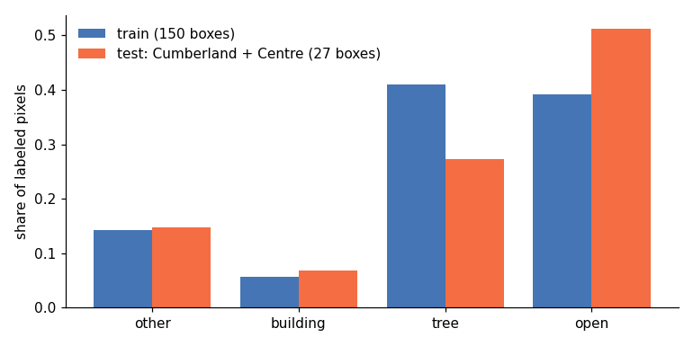

Two kinds of data feed this half of the project. Aerial images with land cover labels train and test the models. Lot, building and street layers from the two cities feed the lot tool. Large files live on an external data drive (`ADU_DATA_DIR`, default `~/musa-drive`). Nothing large is in the repository. The full source list with record counts and licenses is in `docs/DATA.md` in the repository.

## Images and labels for the land cover model

<!-- sources: ~/musa-drive/processed/vision/class_shares.json, ~/musa-drive/processed/vision/city/<city>/summary.json -->

| Data | Source | Date | Pixel | Used for |
|---|---|---|---|---|
| Aerial images, red, green, blue, near infrared | NAIP via Microsoft Planetary Computer | 2022 | 0.6 m | Model input |
| Training and test labels | Chesapeake Bay Program land use and land cover, 2024 edition, "2022" epoch | 2021 to 2022 | 1 m | Training, validation, county test |
| Philadelphia city labels | Philadelphia Land Cover 2018, University of Vermont Spatial Analysis Lab for the city, 7 classes | 2018 (2017 NAIP, 2018 lidar) | 2 ft | City test, city fine-tune, Philadelphia lot cover |
| Pittsburgh city labels | High resolution land cover for Pittsburgh watersheds, University of Vermont Spatial Analysis Lab, USDA Forest Service archive | 2019 (2019 NAIP, 2015 lidar) | 2 ft | City test, city fine-tune, per-lot check |

### Sample design

- 173 boxes of 1 km x 1 km around tract population centers in the Chesapeake Bay counties of Pennsylvania. Four more boxes on the New York line had no 2022 Pennsylvania image and were dropped.
- Split by county so no county is in two roles: 122 train boxes (27 counties), 24 validation boxes (7 counties), 27 test boxes (Cumberland and Centre).
- Labeled pixels: 488,290,379 train, 96,124,030 validation, 109,183,195 test.
- City boxes: 40 per city. Philadelphia 22 train, 6 validation, 12 test. Pittsburgh 25 train, 6 validation, 9 test.
- In Pittsburgh 34.8 % of the test box area was also inside train or validation boxes. City test scores now leave those pixels out. See the results page.

### Label classes

The Chesapeake codes are grouped into 4 classes, or 5 with hard surface split out.

| Class | Chesapeake codes |
|---|---|
| building | 21 structures |
| tree | 23 to 26 tree canopy over roads, structures, paving and turf. 40 and 41 forest. Forested wetlands |
| open ground | 27 turf grass, 28 bare developed, succession, harvested forest, cropland, pasture |
| hard surface (5-class only) | 20 roads, 22 other impervious, 31 extractive impervious |
| other | water, wetlands without trees, barren, solar fields. In the 4-class set roads and paving are here too |

<!-- source: ~/musa-drive/processed/vision/class_shares.json -->

| Share of labeled pixels | other | building | tree | open | hard |
|---|---|---|---|---|---|
| Train, 4 classes | 0.1458 | 0.0583 | 0.4076 | 0.3882 | |
| Test, 4 classes | 0.1473 | 0.0684 | 0.2726 | 0.5118 | |
| Train, 5 classes | 0.0189 | 0.0583 | 0.4076 | 0.3882 | 0.1269 |
| Test, 5 classes | 0.0095 | 0.0684 | 0.2726 | 0.5118 | 0.1378 |

The test counties have less tree and more open ground than the training counties.

The city rasters have 7 classes. They are grouped the same way, and "other" is water only.

<!-- source: ~/musa-drive/processed/vision/city/<city>/summary.json -->

| City test boxes, share | other (water) | building | tree | open | hard |
|---|---|---|---|---|---|
| Philadelphia (12 boxes) | 0.0 | 0.3793 | 0.0888 | 0.1272 | 0.4047 |
| Pittsburgh (9 boxes) | 0.0082 | 0.1102 | 0.4861 | 0.1645 | 0.231 |

## Images and labels for the structure detector

- PEMA Orthoimagery Cycle 2, 0.5 ft pixels, leaf off, from PASDA. Pittsburgh: flown 2022-03-16 to 2022-04-12. Philadelphia: flown 2020-12-11 to 2021-03-22.
- 60 sample areas per city, 540 chips of 640 px per city.
- Labels are first pass. They come from building footprints and OpenStreetMap pools, not from looking at the image. No chip has been checked by hand yet.

## Lot, building and street data for the lot tool

<!-- sources: docs/DATA.md built tables, ~/musa-drive/lots/<city>/manifest.json -->

| | Philadelphia | Pittsburgh |
|---|---|---|
| Lot outlines | Water Department parcels joined to Office of Property Assessment records | Allegheny County parcels joined to county assessments |
| Lots kept (1 to 4 unit homes) | 459,998 | 92,081 |
| Building outlines | City L&I footprints with height | County roof outlines, Microsoft outlines where the county has none, city heights |
| Streets and alleys | City street centerlines, OpenStreetMap service ways | County street centerlines (alley code A73) |
| Zoning | Base districts and overlays | Districts and overlays, steep slope, landslide, historic, flood |
| Land cover per lot | City 2018 raster | U-Net `r34_c5_s0` on NAIP 2022 |
| Local projection | EPSG:2272 (feet) | EPSG:2272 (feet) |

Both cities are measured in feet in EPSG:2272, NAD83 Pennsylvania South (`pipeline/places/pittsburgh.py`, `pipeline/fit.py`).

## Notes

- Eastern Pennsylvania NAIP is in UTM 18N, western in UTM 17N. Each box keeps its own projection.
- The Chesapeake labels and NAIP 2022 are at most about a year apart. The labels also use older lidar for tree height.
- NAIP 2022 over Philadelphia was flown on 2022-04-30, 05-10 and 05-17, early in the leaf season. Over Pittsburgh it was flown on 2022-05-09.
- No Chesapeake labels exist for western Pennsylvania. Pittsburgh is tested only against the 2019 city raster.
- Parcel owner names are not downloaded.
