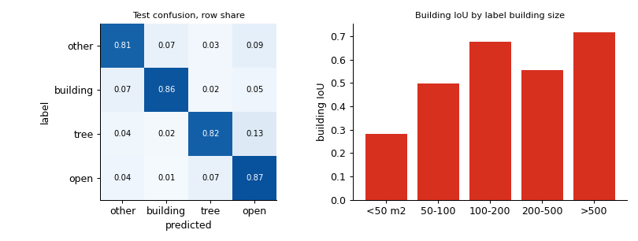
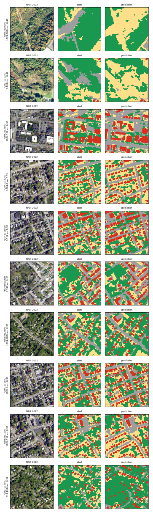
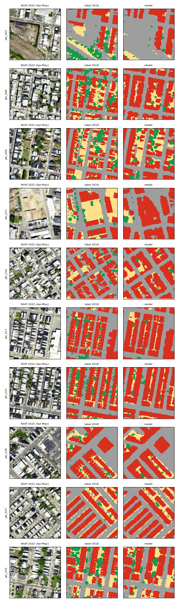
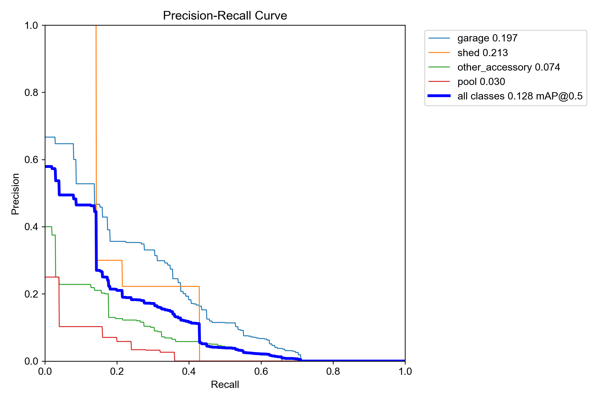
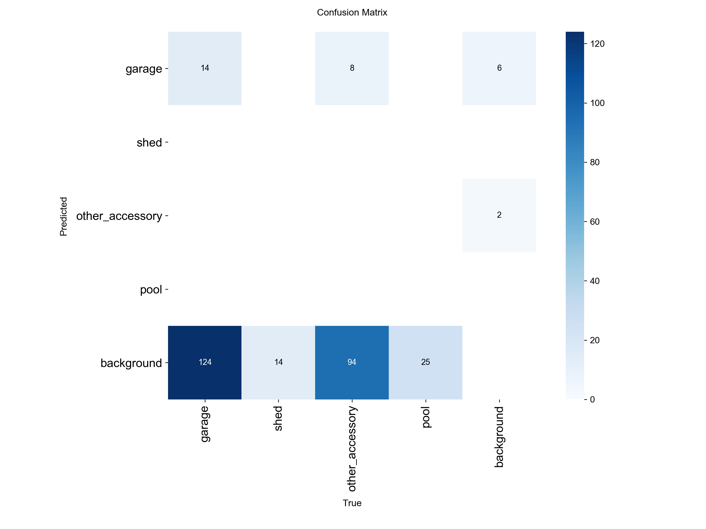
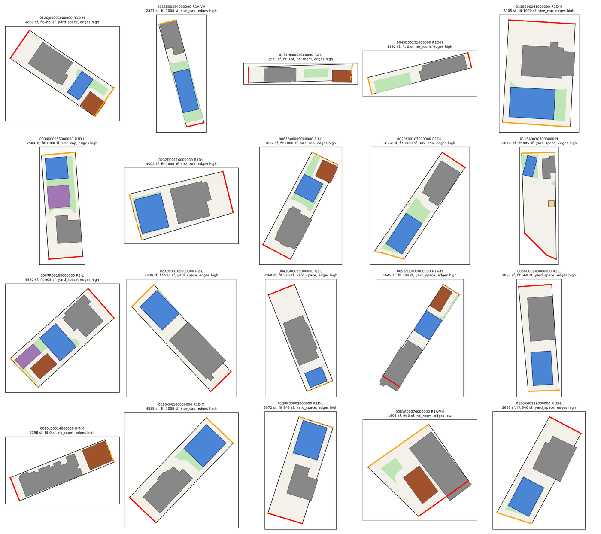

Short version:

- Every pretrained U-Net variant lands near 0.70 test mIoU on the held-out counties. A goal of 0.72 was not reached. No run reached building IoU 0.65. The error analysis says the labels are the limit.
- In Pittsburgh the model transfers well without city training: about 0.70 on clean test pixels. City fine-tuning did not help.
- In Philadelphia the model cannot see trees or lawns in the 2022 spring photos (tree IoU about 0.26). The lot tool uses the city's 2018 land cover raster there instead.
- The structure detector is a first pass. Its scores are agreement with unchecked labels, not accuracy.
- The lot tool's fit test is a vector test on lot lines, buildings and streets with rule-based setbacks. Land cover adds context.
- No hand-labeled lot exists yet, so the fit answers have not been checked against a person looking at the lot.

## 1. Model comparison on the held-out counties

Test: every labeled pixel of the 27 boxes in Cumberland and Centre counties, 109,183,195 pixels. Every run is scored on the same pixels with the same code. "TTA" averages 8 flips and turns.

<!-- source: ~/musa-drive/models/<run>/test_scores.json, test_scores_single.json, result.json; ~/musa-drive/models/external/unet_v2_r34/test_scores.json -->

| Run | Test mIoU, TTA | Single pass | Other | Building | Tree | Open | Edge band left out | Best val mIoU | Minutes |
|---|---|---|---|---|---|---|---|---|---|
| `r34ndvi_c4_s1` (NDVI band) | 0.7005 | 0.6952 | 0.6525 | 0.6427 | 0.7114 | 0.7952 | 0.7668 | 0.7339 | 48.8 |
| `r34_c4_s1` (base) | 0.699 | 0.6939 | 0.6518 | 0.6404 | 0.71 | 0.7936 | 0.7648 | 0.7348 | 51.1 |
| `r34_c4_s1_lowlr` (4 more epochs) | 0.6989 | not run | 0.654 | 0.6451 | 0.7048 | 0.7915 | 0.7652 | 0.7366 | 13.9 |
| `r34_c4_s2` (seed 2) | 0.6987 | 0.6953 | 0.6516 | 0.6356 | 0.7112 | 0.7962 | 0.7646 | 0.734 | 53.3 |
| `unet_v2_r34` (earlier published model) | 0.6985 | not run | 0.6501 | 0.6449 | 0.706 | 0.7929 | 0.7643 | not in file | not in file |
| `r34ce_c4_s1` (no Dice) | 0.6959 | 0.6914 | 0.6487 | 0.6303 | 0.711 | 0.7934 | 0.7612 | 0.7296 | 48.7 |
| `r34_c5_s0` merged to 4 classes | 0.6957 | not run | 0.6469 | 0.638 | 0.7075 | 0.7905 | 0.7611 | 0.7121 (5 classes) | 54.8 |
| `plain_c4_s1` (no pretrained encoder) | 0.683 | 0.6793 | 0.6372 | 0.6091 | 0.6972 | 0.7886 | 0.7452 | 0.7154 | 94.2 |

Course baselines from the notebooks, same test pixels:

<!-- source: musa6950/notebooks/02_random_forest.ipynb, musa6950/notebooks/03_unet.ipynb -->

| Model | Other | Building | Tree | Open | mIoU |
|---|---|---|---|---|---|
| Random Forest, pixel features with NDVI | 0.3211 | 0.2666 | 0.3679 | 0.4853 | 0.3602 |
| First U-Net (v1), plain, 10 epochs | | | | | 0.648 |

The 5-class run on its own 5 classes:

<!-- source: ~/musa-drive/models/r34_c5_s0/test_scores.json -->

| `r34_c5_s0` | Other | Building | Tree | Open | Hard | mIoU |
|---|---|---|---|---|---|---|
| IoU | 0.4714 | 0.638 | 0.7075 | 0.7905 | 0.6567 | 0.6528 |
| Precision | 0.5999 | 0.7171 | 0.823 | 0.9064 | 0.7717 | |
| Recall | 0.6877 | 0.8526 | 0.8344 | 0.8607 | 0.8151 | |

Per place type (test mIoU, TTA):

<!-- source: ~/musa-drive/models/<run>/test_scores.json by_group -->

| Run | Urban | Suburban | Rural |
|---|---|---|---|
| `r34ndvi_c4_s1` | 0.6443 | 0.7363 | 0.7165 |
| `r34_c4_s1` | 0.6428 | 0.7331 | 0.7181 |
| `unet_v2_r34` | 0.6438 | 0.7324 | 0.7178 |
| `plain_c4_s1` | 0.6228 | 0.7171 | 0.7049 |
| `r34_c5_s0` (5 classes) | 0.6502 | 0.636 | 0.6082 |

What it shows:

- The pretrained encoder is worth about 0.016 test mIoU (0.699 against 0.683). Nothing else moves the score more than 0.005.
- Seeds, NDVI, Dice and more epochs all land between 0.6959 and 0.7005. The model has stopped improving on these labels.
- Single-pass scores are 0.004 to 0.005 below the TTA scores.
- Urban boxes are the weak place type in every 4-class run.
- The 5-class run pays for the extra class: "other" drops to 0.4714 once roads and paving leave it, and rural and suburban mIoU fall.

## 2. Where and why the model fails

<!-- source: ~/musa-drive/processed/vision/error_analysis.md (unet_v2_r34) -->

- Tree against open ground is 47 % of all wrong pixels (open called tree 24.2 %, tree called open 23.1 %).
- The 1 pixel band along label edges is 9.9 % of pixels but 32.3 % of errors. Error rate 49.9 % in the band and 11.5 % inside. Without the band, mIoU is 0.764.
- Small buildings fail: building IoU 0.28 under 50 m2, 0.50 for 50 to 100 m2, 0.68 to 0.72 above 100 m2 (0.55 for 200 to 500 m2, where paved lots merge into roofs).

<!-- source: ~/musa-drive/processed/vision/error_analysis.md -->

| Chesapeake code | Share of test | Error rate | Share of all errors | What the model says |
|---|---|---|---|---|
| 27 turf grass | 16.9 % | 23.7 % | 26.2 % | 12 % tree, 8 % other |
| 22 other impervious | 9.4 % | 22.6 % | 13.9 % | 11 % building |
| 26 tree canopy over turf | 5.3 % | 38.5 % | 13.4 % | 29 % open |
| 41 forested other | 4.1 % | 28.4 % | 7.6 % | 23 % open |
| 25 canopy over other impervious | 0.5 % | 65.6 % | 2.2 % | 41 % other |

- The two worst tiles are a forest edge and a meadow in Centre County, flown in fall colors. The label has patches the photo does not show. This is a season or label problem.
- Most other bad tiles are dense older neighborhoods in Cumberland. Errors sit on crown edges, canopy over streets and alleys next to houses.
- Shifting the prediction by (-2, -1) pixels raises mIoU from 0.699 to 0.708. Label and image are off by about a pixel in places.
- The label calls canopy over lawns and paving tree because of lidar height. The photo shows lawn or paving under thin crowns.

Conclusion: about 0.06 mIoU sits in pixels where the label itself is uncertain. Reaching 0.72 on these labels is unlikely from longer training. Gains would need cleaner tree and grass labels, scoring that matches the per-lot use, or more small-building examples.

## 3. Transfer to Pittsburgh and Philadelphia

### Pittsburgh, and the overlap leak

The first Pittsburgh split placed some test boxes on top of training boxes: 34.8 % of the test box area was also inside train or validation boxes. A fine-tune score of 0.719 came from that split. It is withdrawn. The split code now keeps boxes apart, and city scores leave out overlapping pixels.

<!-- source: ~/musa-drive/models/r34_c5_s0/city_pittsburgh_scores_clean.json, ~/musa-drive/models/ft_c5_pittsburgh/city_pittsburgh_scores_clean.json, ~/musa-drive/models/ft_c5_pittsburgh/city_pittsburgh_scores.json -->

| Pittsburgh, 9 test boxes | Test pixels | mIoU without water | As 4 classes | Building | Tree | Open | Hard | Water |
|---|---|---|---|---|---|---|---|---|
| Zero-shot `r34_c5_s0`, clean | 4,839,728 | 0.7036 | 0.7039 | 0.7335 | 0.8116 | 0.5595 | 0.7097 | 0.7007 |
| Fine-tuned `ft_c5_pittsburgh`, clean | 4,839,728 | 0.6941 | 0.6875 | 0.686 | 0.8203 | 0.5619 | 0.7083 | 0.0 |
| Fine-tuned, overlapping pixels kept (withdrawn) | 7,122,645 | 0.7194 | 0.7146 | 0.7288 | 0.8393 | 0.5806 | 0.729 | 0.0 |

- The original model is fine in Pittsburgh: 0.70 on clean pixels.
- Fine-tuning lowered building IoU (0.7335 to 0.686) and lost the water class entirely. Pittsburgh lot cover uses the zero-shot model.
- Open ground is the weak class in the city (0.56).

### Philadelphia, an honest negative result

<!-- source: ~/musa-drive/models/r34_c5_s0/city_philadelphia_scores.json, ~/musa-drive/models/ft_c5_philadelphia/city_philadelphia_scores.json -->

| Philadelphia, 12 test boxes | mIoU, 5 classes | As 4 classes | Building | Tree | Open | Hard |
|---|---|---|---|---|---|---|
| Zero-shot `r34_c5_s0` | 0.3838 | 0.4798 | 0.7072 | 0.2622 | 0.272 | 0.6775 |
| Fine-tuned `ft_c5_philadelphia` | 0.4078 | 0.5097 | 0.7386 | 0.2606 | 0.3226 | 0.717 |

<!-- source: ~/musa-drive/processed/vision/city/philadelphia/diagnosis/diagnosis.md -->

- No bug: class mapping, alignment, footprint burn-in and nodata all check out.
- NAIP 2022 over Philadelphia was flown on 2022-04-30, 05-10 and 05-17, early in the leaf season. The 2018 label was built from leaf-on 2017 photos and 2018 lidar.
- Rowhouse back yards are narrow strips in deep shadow. The label says grass or small tree. The photo shows dark paving.
- Even large canopy is mostly missed: tree recall is 0.41 for patches over 200 m2 and 0.081 under 10 m2.
- A plain NDVI threshold gets vegetation IoU 0.485 on test, close to the model (0.448). The photos carry little green.
- Decision: in Philadelphia the lot tool uses the city's 2018 raster for land cover. Buildings from the model are fine (IoU 0.73), but footprints are newer anyway.

### Per-lot agreement with the city rasters

<!-- source: ~/musa-drive/processed/pittsburgh/cover_compare_r34_c5_s0.json, ~/musa-drive/processed/philadelphia/cover_compare.json. MAE in percentage points of lot area, r = correlation. Lots with at least 90 % raster coverage, outside the city train and validation boxes. -->

| | Lots | Tree MAE (r) | Open MAE (r) | Vegetation MAE (r) | Building MAE (r) | Tree, raster mean | Tree, model mean |
|---|---|---|---|---|---|---|---|
| Pittsburgh, `r34_c5_s0` against the 2019 raster | 128 | 8.41 (0.862) | 11.02 (0.844) | 8.16 (0.884) | 7.32 (0.86) | 18.6 % | 12.5 % |
| Philadelphia, `ft_c5_philadelphia` against the 2018 raster | 430,161 | 6.71 (0.622) | 12.02 (0.626) | 13.65 (0.76) | 17.66 (0.805) | 9.4 % | 5.3 % |

- The Pittsburgh check has only 128 lots. The 2019 raster covers part of the city, and 801 lots inside train and validation boxes were left out. It is a small check.
- The Pittsburgh lot records carry a note: tree share is off by about 8 points on average and building share reads high.
- On Philadelphia rowhouse lots (306,228) the model reads vegetation 13.4 % against 24.4 % in the raster.

## 4. Structure detector

<!-- source: ~/musa-drive/models/yolo/runs/real/eval/eval.json -->

| Test set | Chips | mAP50 | Garage AP50 | Shed AP50 | Other accessory AP50 | Pool AP50 | Precision | Recall |
|---|---|---|---|---|---|---|---|---|
| Both cities | 162 | 0.1692 | 0.2584 | 0.0331 | 0.2197 | 0.1656 | 0.4471 | 0.2237 |
| Pittsburgh | 81 | 0.1934 | 0.3337 | 0.0466 | 0.2001 | no labels | 0.5709 | 0.2601 |
| Philadelphia | 81 | 0.1815 | 0.16 | 0.026 | 0.2748 | 0.2653 | 0.4722 | 0.2112 |

- The test labels are first-pass labels from footprints and OpenStreetMap. They were not checked by hand. A real shed missing from the footprints counts against the model when it finds one. These are not accuracy numbers.
- At a 0.25 score threshold the model predicts only the garage class. It finds 23 of 127 labeled garages.
- Sheds are not detectable at this stage (AP50 0.0331).
- A review pack of 150 chips per city is ready for hand checking. It has not been done.

## 5. How the models feed the lot tool

- **Land cover:** each lot record has a `cover` block (building, tree, open ground, hard surface, impervious share, source, date) and the cover inside the suggested spot. Pittsburgh: `model:r34_c5_s0`, 2022. Philadelphia: `landcover_2018`. The fit test does not use it. It tells the user how much canopy a unit might remove.
- **Detector:** not used. Lot records carry an empty `objects` list. Garages and sheds come from building footprints by size (180 sq ft or more is a garage).
- **Fit:** a vector test on the lot outline, edges labeled front, side and rear, building outlines, setbacks from the rule files, and the largest rectangle that fits. See the methods page.

## 6. Lot results

Three scenarios on every lot: today's law, local reform (Philadelphia Bill 250042, in Pittsburgh equal to today) and state reform (HB 2186). The bills are not law. The state session ends Nov 30, 2026.

<!-- source: ~/musa-drive/lots/pittsburgh/stats.json (data version pittsburgh-20261111-bdeb5697ae, manifest built 2026-11-11T20:30:22) and ~/musa-drive/lots/philadelphia/stats.json and manifest.json (data version philadelphia-20261111-b7fa7bda07, built 2026-11-11T21:41:43) -->

| Share of lots | Pittsburgh | Philadelphia |
|---|---|---|
| Lots | 92,081 | 459,998 |
| Any legal ADU path today | 1.0 | 0.012<!-- stats.json all.paths.today.allowed --> |
| New detached unit by right today | 0.0 | 0.0<!-- stats.json all.paths.today.detached_by_right --> |
| Any legal path, local reform | 1.0 | 0.533<!-- stats.json all.paths.local_reform.allowed --> |
| Any legal path, state reform | 1.0 | 1.0<!-- stats.json all.paths.state_reform.allowed --> |
| A detached unit fits, today | 0.658 | 0.0<!-- stats.json all.paths.today.detached_fits --> |
| A detached unit fits, state reform | 0.7 | 0.26<!-- stats.json all.paths.state_reform.detached_fits --> |
| 600 sq ft detached fits, today | 0.412 | 0.0<!-- stats.json all.fit_600 --> |
| 600 sq ft detached fits, state reform | 0.459 | 0.076<!-- stats.json all.fit_600_state_reform --> |
| Median largest detached footprint where one fits (sq ft) | 764 | none fits<!-- stats.json all.median_largest_sqft --> |
| Garage-size accessory building on the lot | 0.228 | 0.015<!-- stats.json all.garage_candidate --> |
| Lot edges labeled with high confidence | 0.85 | 0.917<!-- stats.json all.edge_confidence.high --> |

- **Pittsburgh:** under Ordinance 31-2026 (signed Oct 29, 2026) internal and attached units are by right. A new detached unit in a side or rear yard needs an Administrator's Exception. So every lot has a legal path, and none has a detached unit by right today. The binding limit is yard space.
- **Philadelphia:** about 1.2 percent of lots have any legal ADU path today, and no lot can add a new detached unit by right. The limits come from the zoning code and its overlays. The binding limit is the law.

Pittsburgh by housing type:

<!-- source: ~/musa-drive/lots/pittsburgh/stats.json by_type (data version pittsburgh-20261111-bdeb5697ae) -->

| Housing type | Lots | Detached fits, today | 600 sq ft fits, today | 600 sq ft fits, state reform | Median largest (sq ft) | Main limit |
|---|---|---|---|---|---|---|
| Single family detached | 64,578 | 0.729 | 0.482 | 0.536 | 830 | yard space 0.43 |
| Two family | 7,780 | 0.605 | 0.372 | 0.402 | 745.5 | yard space 0.402 |
| Three family | 2,041 | 0.619 | 0.381 | 0.413 | 750 | yard space 0.403 |
| Four family | 881 | 0.602 | 0.412 | 0.446 | 892 | no room 0.398 |
| Semi-detached | 5,976 | 0.531 | 0.246 | 0.292 | 574 | no room 0.469 |
| Rowhouse | 10,825 | 0.35 | 0.121 | 0.136 | 488 | no room 0.65 |

What stops a detached unit in Pittsburgh today, all lots: yard space 0.414, no room at all 0.342, the 1,000 sq ft size cap 0.244. 28.4 % of lots sit on steep slope or landslide-prone ground, a flag the fit does not act on.

Philadelphia by housing type:

<!-- source: ~/musa-drive/lots/philadelphia/stats.json by_type -->

| Housing type | Lots | Any legal path today | Any legal path, local reform | 600 sq ft fits, state reform |
|---|---|---|---|---|
| Rowhouse | 329,279<!-- by_type.rowhouse.lots --> | 0.007<!-- by_type.rowhouse.paths.today.allowed --> | 0.541<!-- by_type.rowhouse.paths.local_reform.allowed --> | 0.016<!-- by_type.rowhouse.fit_600_state_reform --> |
| Semi-detached | 65,806<!-- by_type.semi_detached.lots --> | 0.03<!-- by_type.semi_detached.paths.today.allowed --> | 0.495<!-- by_type.semi_detached.paths.local_reform.allowed --> | 0.18<!-- by_type.semi_detached.fit_600_state_reform --> |
| Single family detached | 26,949<!-- by_type.single_family_detached.lots --> | 0.023<!-- by_type.single_family_detached.paths.today.allowed --> | 0.408<!-- by_type.single_family_detached.paths.local_reform.allowed --> | 0.536<!-- by_type.single_family_detached.fit_600_state_reform --> |
| Two to four family | 37,964<!-- by_type.two_to_four_family.lots --> | 0.013<!-- by_type.two_to_four_family.paths.today.allowed --> | 0.621<!-- by_type.two_to_four_family.paths.local_reform.allowed --> | 0.087<!-- by_type.two_to_four_family.fit_600_state_reform --> |

<!-- source: ~/musa-drive/lots/pittsburgh/qa/contact_seed2029.png (20:49 build), shrunk for the page -->

## 7. Hand-label check

<!-- source: ~/musa-drive/validation/DESIGN.md, ~/musa-drive/validation/results/<city>.json -->

250 lots are sampled, 125 per city, with sheets and image chips ready. 0 are labeled. There is no measured agreement between the fit answer and a person looking at the lot. This is the most important missing check.

## 8. Limits

- Land cover scores sit near 0.70 on the held-out counties. The labels set the ceiling.
- Philadelphia tree and open ground from NAIP 2022 are not reliable. The 2018 raster misses changes since 2018.
- The Pittsburgh per-lot land cover check covers 128 lots.
- The detector is not checked against hand labels and is not used in the lot records.
- The fit answers are not checked against hand labels.
- Lot lines come from county and city parcel maps. They are not a survey. Building outlines can be old or merged.
- Rules come from rule files read from the codes. This is not legal advice and not a zoning determination. The bills behind the reform scenarios are not law.
- Slope, flood and historic flags are shown but do not change the fit answer.
