All numbers below come from the executed notebooks in `musa6950/notebooks/`.
Hand labels are not made yet, so the fit rule has no hand-label check so far.

## Data check

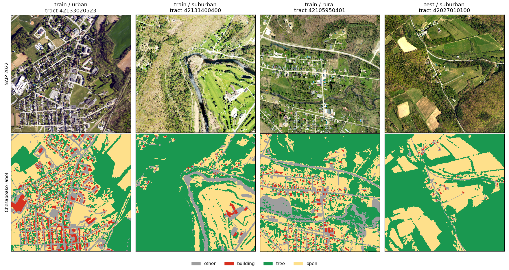

- 177 boxes were picked. 4 on the New York line have no 2022 PA image. 173 are used: 146 train, 27 test
- Labels sit on the image grid (same transform and size)
- The test counties have less tree and more open ground than train

| Share of labeled pixels | other | building | tree | open |
|---|---|---|---|---|
| Train (146 boxes) | 0.143 | 0.056 | 0.410 | 0.391 |
| Test, Cumberland + Centre (27 boxes) | 0.147 | 0.068 | 0.273 | 0.512 |

## Model accuracy

Test = every labeled pixel in the 27 test boxes (109,183,195 pixels). All models are scored on the same pixels. The test counties were scored once, after every choice was made on validation.

Two U-Nets:
- v1: the first run. Plain U-Net, 7.8 M parameters, 10 epochs, 45 min
- v2: the final model. U-Net with an ImageNet ResNet-34 encoder, 24.4 M parameters, 14 epochs, 95 min. Predictions averaged over 8 flips and turns, plus a small tree offset set on validation

| IoU on test counties | Random Forest | U-Net v1 | U-Net v2 | Gain v1 to v2 |
|---|---|---|---|---|
| other | 0.321 | 0.601 | 0.650 | +0.049 |
| building | 0.267 | 0.543 | 0.645 | +0.102 |
| tree | 0.368 | 0.672 | 0.706 | +0.034 |
| open ground | 0.485 | 0.775 | 0.793 | +0.018 |
| mean IoU | 0.360 | 0.648 | 0.699 | +0.051 |
| pixel accuracy | 0.571 | 0.824 | 0.847 | +0.024 |

| Test, U-Net v2 | other | building | tree | open |
|---|---|---|---|---|
| precision | 0.771 | 0.723 | 0.838 | 0.896 |
| recall | 0.806 | 0.857 | 0.817 | 0.874 |
| precision, v1 | 0.741 | 0.621 | 0.837 | 0.877 |
| recall, v1 | 0.761 | 0.812 | 0.773 | 0.870 |

| Mean IoU by group (test) | Random Forest | U-Net v1 | U-Net v2 |
|---|---|---|---|
| urban | 0.322 | 0.588 | 0.644 |
| suburban | 0.358 | 0.681 | 0.732 |
| rural | 0.388 | 0.672 | 0.718 |

- Random Forest: 290,219 training pixels (500 per class per box), R, G, B, NIR, NDVI. NDVI is the top feature (0.275)
- The biggest gain is buildings: +0.102 IoU. Fewer roofs are mixed up with paving. 7.4% of building pixels are called other (12.3% in v1)
- Every group gains about 0.05. Urban boxes still score lowest (0.644)
- Main mix-up left: 13.0% of tree pixels are called open ground (16.6% in v1), and 7.2% of open ground is called tree
- In Assignment 6 bare soil got 0 IoU. Here it is inside "open ground", which scores best

What helped (validation, 24 boxes in 7 held-back counties, every pixel):

| Run | Val mIoU at epoch 3 | Best val mIoU | Epochs | Minutes |
|---|---|---|---|---|
| v1 plain U-Net, old recipe | | 0.689 | 10 | 45 |
| plain U-Net, new recipe | 0.669 | 0.669 | 3 | 22 |
| ResNet-34, CE + Dice, new recipe | 0.711 | 0.729 | 9 | 44 |
| same + NDVI as a 5th band | 0.686 | 0.704 | 3 | 27 |
| same, cross entropy only | 0.705 | 0.709 | 5 | 23 |
| final: ResNet-34, 16 epoch schedule | 0.707 | 0.736 | 14 | 95 |
| final + 8 flips and turns | | 0.740 | | |
| final + flips + tree offset 0.5 | | 0.742 | | |

- New recipe = random 384 px crops from whole boxes, 1 in 3 centered on a building, flips, 90 degree turns, brightness and contrast jitter, AdamW with warmup and cosine decay
- Short runs were cut by a time cap, so they are compared at epoch 3, where the learning rate is the same
- Pretrained encoder: +0.04 at epoch 3 (0.711 vs 0.669 for a plain U-Net with the same recipe). The largest single gain
- Longer training: +0.007 (0.729 to 0.736). Validation was flat from epoch 12 on
- Dice loss: +0.006 at epoch 3, +0.014 at epoch 5. Kept
- NDVI: -0.024 at epoch 3. Dropped. The network already gets R and NIR, so NDVI adds little
- 8 flips and turns at prediction: +0.004. Kept
- Tree offset: +0.002 on validation, and the share of pixels called tree goes from 94% to 100% of the label share. Kept
  - Why: the first test run of v2 (mIoU 0.692, no offset) looked fine, but on the Cumberland check lots in notebook 05 it called much less tree than the label (median 56 vs 159 m2 per lot). That made `fits_keep_trees` too high
  - The offset (0.5 added to the tree log chance) was picked on validation only. The test was then scored once more with it
- The old v1 score of 0.682 was on 256 px tiles. On whole validation boxes it is 0.689, the number used here
- Total training time for all runs: about 3.5 hours on a Mac (MPS), with one 38 minute stall in the final run

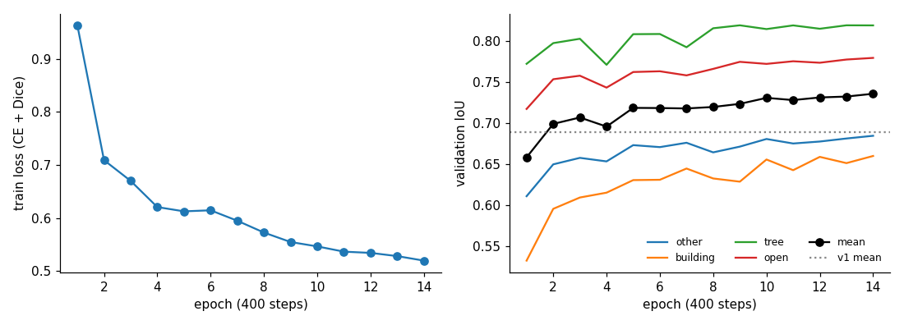

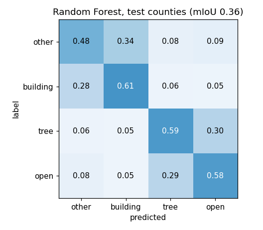

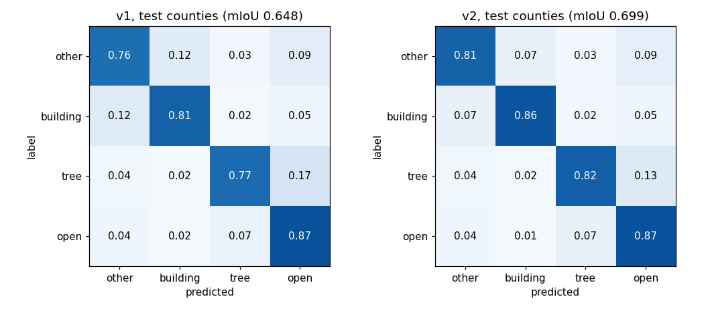

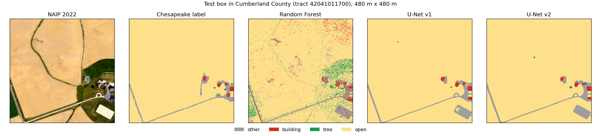

- The Random Forest is speckled pixel by pixel. The U-Nets give clean shapes
- On this farm box v1 and v2 look alike. Both find a paved pad (bottom right) that the label does not have. The label and the image differ in date here
- In the urban figure below, v2 gives whole large roofs where v1 breaks them into pieces

Test boxes per group, the median box and the worst box (image, label, v1, v2, v2 errors in red):

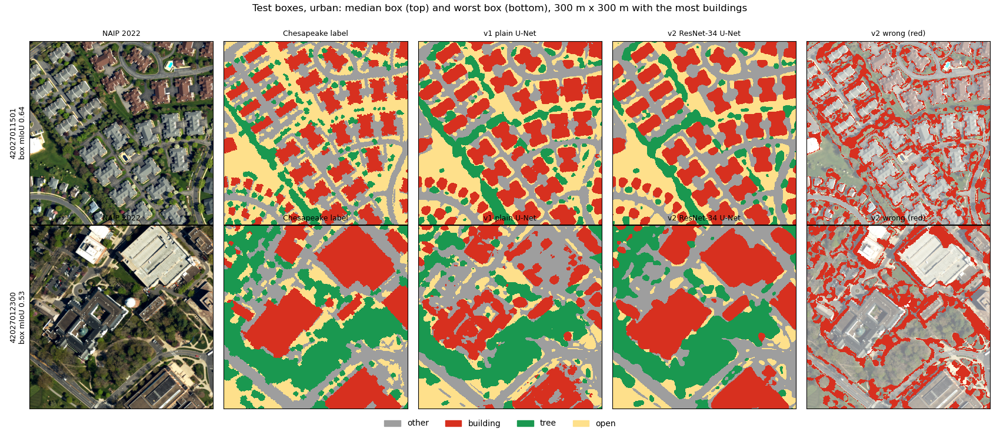

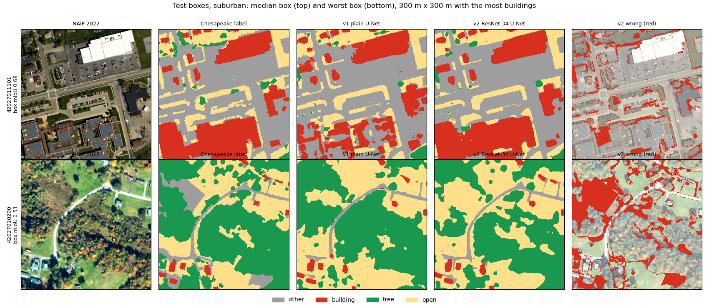

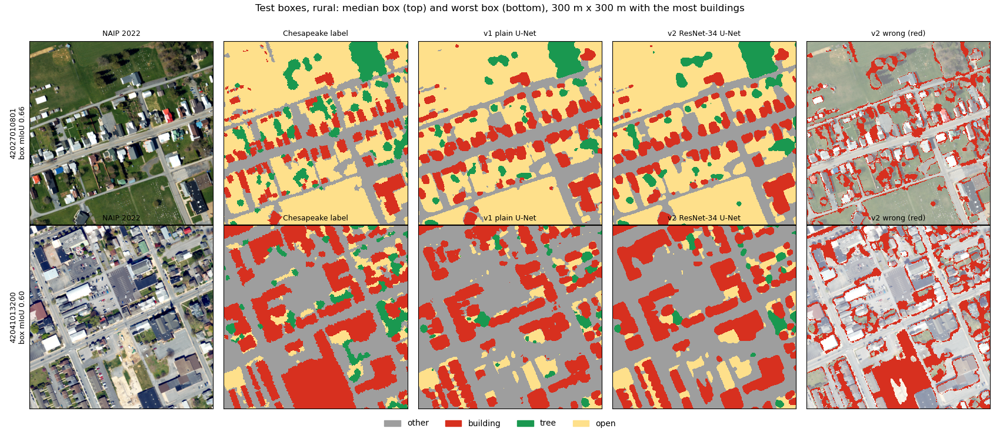

### Leakage check

- No test county (Cumberland, Centre) is in train or validation. No validation county is in train
- No two boxes of different roles touch on the ground (checked on the real image extents)
- Two pairs of boxes overlap inside one role: two train boxes in Dauphin (0.15 km2), and two Cumberland test boxes (0.09 km2). The test pair only counts about 0.2% of test pixels twice. It is not leakage

### How high can it go?

The Chesapeake label is not perfect, so 1.0 is out of reach. Checks on the test boxes:
- Edges: the label is 1 m, put on the 0.6 m grid. 9.9% of test pixels sit in a 1 pixel band along a label edge. 32.3% of v2 errors are in that band
- Secondary score, edge band left out: mIoU 0.764 (v1: 0.703). This is not the main score. It shows how much is edge noise
- Registration: moving the prediction 2 pixels up and 1 left scores 0.708 instead of 0.699. So the label and the image are off by about 1 m in places. That error can not be learned away
- Dates: some test images do not match the label. The worst box (Centre, mIoU 0.51) was flown in fall, and a clearing the label calls tree is cut in the image. In Cumberland a new paved pad is in the image but not in the label
- Box scores run from 0.51 to 0.77 (median 0.66)
- Tree vs open ground is the biggest error left. The label splits them partly by height (from lidar), which a flat image can not always see

Realistic ceiling: about 0.75-0.78 mIoU against this label on these counties. Edge noise alone is worth about 0.07 (0.764 with the edge band out), and the 1 m offset and image dates cost a bit more. Validation, in other counties, tops out at 0.742. v2 at 0.699 has closed about 40% of the gap from v1 to that ceiling. More gains would need better labels or images from the same date, not a bigger model.

## Garages and sheds

- Outline method only. YOLO is not done (no shed labels yet)
- Single-family lots picked in notebook 04:
  - Philadelphia: 26,270 lots (detached house type, one main outline)
  - Cumberland: 57,664 lots (300-20,000 m2, one main outline)

| | Philadelphia | Cumberland |
|---|---|---|
| Median lot (m2) | 637 | 1,425 |
| Median house outline (m2) | 141 | 187 |
| Lots with a small outline (under 60 m2) | 8.2% | 8.8% |
| Small outlines found | 2,214 | 5,320 |

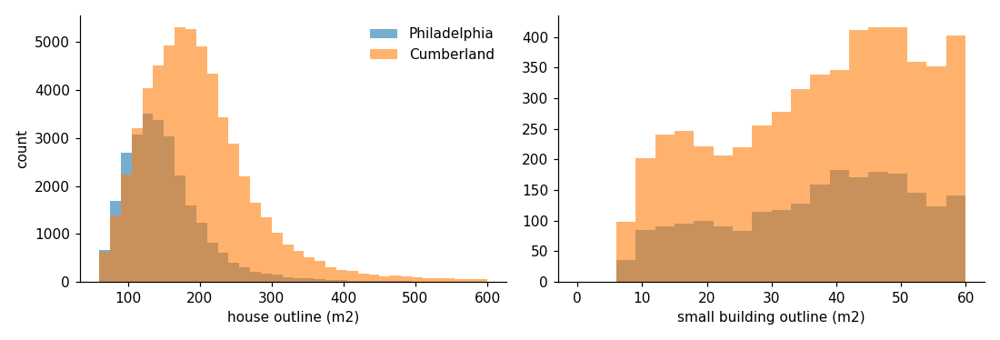

- Under 9% of lots have a garage or shed outline. That looks low. Microsoft outlines likely miss many small sheds, which is what YOLO was meant to test

Is the outline method good enough? Check in notebook 05, Cumberland test boxes, where the Chesapeake label has its own building class:
- 1,143 labeled building patches of 5-60 m2 sit in a backyard (median 18.4 m2)
- Only 33.4% of them touch a Microsoft outline. So the outlines miss about 2 in 3 small structures
- The U-Net calls at least half of the patch building for 35.5% of them. Of the patches with no outline, it catches 13.3%
- 57.7% are missed by both. Most are small. A 10-20 m2 shed is only 30-60 NAIP pixels
- The fit test only allows open ground (and trees). So a shed the U-Net sees already blocks the spot, outline or not. That is the cheap win, and it is already in the rule. `yard_bldg_m2` in `6950_lots_pilot_full.csv` gives the U-Net building area left in each backyard
- Missed sheds still make the fit rule a bit too generous

What YOLO would need: about 300 sheds and garages drawn by hand on NAIP in LabelMe, spread over urban, suburban, and rural lots, plus lots with no shed so it learns to say no. The objects are tiny at 0.6 m, so recall would be the hard part. Ultralytics is AGPL, so it would stay in notebook 04 only. With no hand labels yet, it is not done.

## Room for an ADU

Rule: lot minus 5 ft from lot lines, minus 10 ft around the house, minus other outlines. Then a 20 x 30 ft spot (10 x 15 pixels), both rotations. The land cover is U-Net v2.

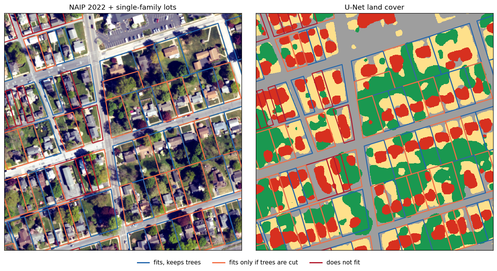

| Pilot county | Lots | Fits (trees may be cut) | Fits keeping trees | Outline only |
|---|---|---|---|---|
| Philadelphia | 26,270 | 48.7% | 22.3% | 57.4% |
| Cumberland | 57,664 | 87.2% | 69.5% | 90.6% |

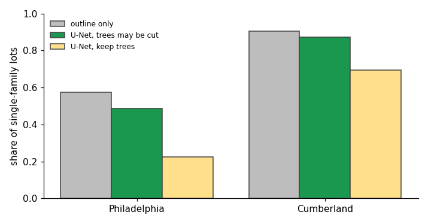

- Median backyard left after setbacks: 223 m2 in Philadelphia, 797 m2 in Cumberland
- Outline-only says yes and U-Net says no on 2,292 Philadelphia lots and 1,959 Cumberland lots. These are yards covered by driveways, patios, or pools. The U-Net never says yes when outline-only says no
- Trees matter most in Philadelphia: keeping trees cuts the fit rate by more than half

Check against real labels (not hand labels). 3,030 Cumberland lots sit inside test boxes, where the Chesapeake label exists. The rule is run with the label map and with the U-Net map:

| Label map = truth | Share yes (label) | Share yes (model) | Precision | Recall | Agreement |
|---|---|---|---|---|---|
| fits, U-Net v2 | 0.646 | 0.641 | 0.973 | 0.966 | 0.961 |
| fits keeping trees, U-Net v2 | 0.419 | 0.464 | 0.807 | 0.895 | 0.867 |
| fits, U-Net v1 (old) | 0.646 | 0.621 | 0.980 | 0.942 | 0.950 |
| fits keeping trees, U-Net v1 (old) | 0.419 | 0.409 | 0.835 | 0.816 | 0.855 |
| fits, outline only | 0.646 | 0.728 | 0.888 | 1.000 | 0.918 |

- The v2 map gives the same answer as the label map on 96.1% of lots (v1: 95.0%). Keeping trees is harder (86.7%, v1: 85.5%)
- Outline only over-counts: it says yes on 72.8% of lots vs 64.6% with the label map
- Open ground per lot: label vs v2 median 287 vs 290 m2, correlation 0.96 (v1: 258 m2)
- Tree area per lot: median 159 vs 92 m2, correlation 0.94 (v1: 106 m2). Both models call less tree in yards than the label. Yard trees are often small or hang over lawns and roofs, which is hard to see from above
- So `fits_keep_trees` is too high: 46.4% yes vs 41.9% with the label. The v2 tree offset (notebook 03) shrinks this gap but does not close it. Without the offset it was 50.8%
- This check is only Cumberland and only tests the land cover step. Hand labels would also test the rule itself

### Largest footprint that fits

- `max_fit_sqft` = largest footprint (100 to 2,000 sq ft, steps of 50) that fits as a square, 2:3, or 1:2 spot
- Median: 500 sq ft in Philadelphia, 2,000 (the top of the ladder) in Cumberland. Keeping trees: 200 and 1,100
- `fits` and `max_fit_sqft >= 600` agree on 98.2% of lots (keeping trees: 97.9%). The target was 99%
  - 1,283 lots fit the 20 x 30 ft rule but no 600 sq ft shape on the ladder. 244 lots are the other way
  - Why: the 20 x 30 ft rule rounds to 10 x 15 pixels (6.0 x 9.0 m, a bit under 600 sq ft). The ladder rounds up, so 600 sq ft at 2:3 is 11 x 16 pixels (6.6 x 9.6 m)
- Map layers for the tool (EPSG:4326):
  - `data/processed/6950_lot_open.gpkg`, layer `open`: 77,513 `open` and 65,997 `tree` shapes. 430 MB
  - `data/processed/6950_lot_spot.gpkg`, layer `spot`: 79,348 `max` and 62,038 `base600` rectangles. 33 MB
  - The spot is the place that fits farthest from the house center. On open ground alone if it fits there, else on open ground + trees

## Statewide

Fit rate by group from the pilot lots. Range = 95% bootstrap, resampling tracts 1,000 times.

| Group | Pilot lots | Pilot tracts | Fit rate (range) | Keep trees rate (range) | Tree cut per fitting lot (m2) |
|---|---|---|---|---|---|
| Urban (RUCA 1) | 70,581 | 342 | 0.719 (0.671-0.764) | 0.494 (0.432-0.551) | 10.3 |
| Suburban (RUCA 2-3) | 9,826 | 11 | 0.966 (0.934-0.990) | 0.873 (0.815-0.931) | 3.2 |
| Rural (RUCA 4-10) | 3,527 | 4 | 0.800 (0.518-0.928) | 0.719 (0.376-0.870) | 2.8 |

- Urban = 26,270 Philadelphia lots + 44,311 Cumberland urban lots. Philadelphia alone is 0.487, Cumberland urban is 0.857
- Suburban and rural come only from Cumberland, from 11 and 4 tracts. The rural range is wide for that reason

Applied to ACS 2020-24 single-family detached homes in all 3,445 PA tracts:

| | Single-family homes | Lots with room | Range | Lots with room, keep trees | Tree canopy cut (m2) |
|---|---|---|---|---|---|
| Urban | 1,858,258 | 1,336,641 | 1,246,978-1,419,250 | 917,162 | 13,800,605 |
| Suburban | 646,067 | 623,836 | 603,107-639,367 | 564,335 | 1,995,117 |
| Rural | 783,142 | 626,160 | 405,305-726,515 | 563,105 | 1,777,454 |
| Pennsylvania | 3,287,467 | 2,586,637 | 2,255,390-2,785,132 | 2,044,602 | 17,573,176 |

- About 2.59 million single-family lots have room for a 20 x 30 ft ADU by this rule (v1: 2.55 million). About 2.04 million without cutting trees (v1: 1.93 million)
- If every fitting lot built one, about 17.57 km2 (4,342 acres) of tree canopy would be cut (v1: 18.65 km2)
- The keep-trees count is likely high, since the U-Net calls less yard tree than the label (see the check above)
- Most of the tree loss is in urban tracts, where yards are small and the spot often needs trees cut
- This is room, not demand. Zoning, slope, septic, and owner choice are not in the rule

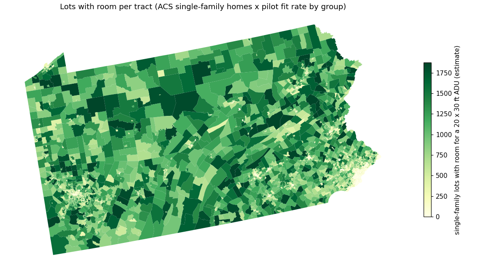

Fit curves: share of pilot lots where a footprint of each size fits (`data/processed/fit_curves.csv`, range = same tract bootstrap):

| Footprint (sq ft) | Urban | Suburban | Rural | Urban, keep trees | Suburban, keep trees | Rural, keep trees |
|---|---|---|---|---|---|---|
| 400 | 0.784 | 0.976 | 0.844 | 0.574 | 0.897 | 0.773 |
| 600 | 0.705 | 0.965 | 0.791 | 0.479 | 0.869 | 0.709 |
| 800 | 0.625 | 0.949 | 0.742 | 0.391 | 0.835 | 0.654 |
| 1,000 | 0.551 | 0.932 | 0.696 | 0.324 | 0.801 | 0.595 |
| 1,200 | 0.503 | 0.921 | 0.665 | 0.279 | 0.773 | 0.557 |

- At 600 sq ft the curve is 0.1-1.4 points under the group rates above (urban 0.705 vs 0.719). The curve uses the ladder shapes, which round up
- Size matters most in urban tracts: going from 600 to 1,000 sq ft drops the share from 0.705 to 0.551

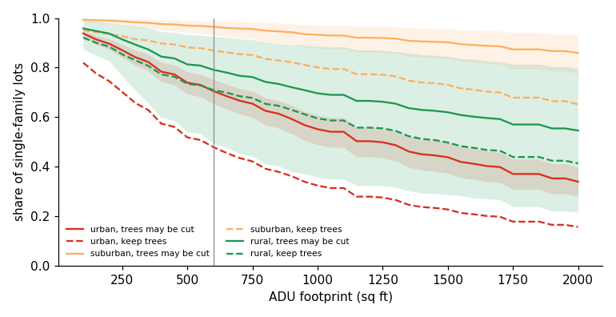

## Limits

- No hand labels yet. The blank form is `data/processed/hand_labels_template.csv` (250 lots)
- Labels only cover the Chesapeake part of PA (central and east). Western PA has no labels. The model is applied there only through the statewide rates, never checked
- The rates come from two counties. All rural PA rests on 4 Cumberland tracts. Western PA towns and Pittsburgh are not in the sample
- Philadelphia rowhouses and twins are left out (Microsoft merges a row into one outline). ACS counts some twins as detached, so Philadelphia tracts may have more homes in `lots_total` than the lots tested
- "Backyard" includes the front yard. Many towns do not allow an ADU in front of the house
- Missed sheds and under-called trees both make the rule a bit generous
- Images and labels are from 2022
- Lot rules (setbacks, minimum lot size) vary by town. One rule is used for all
